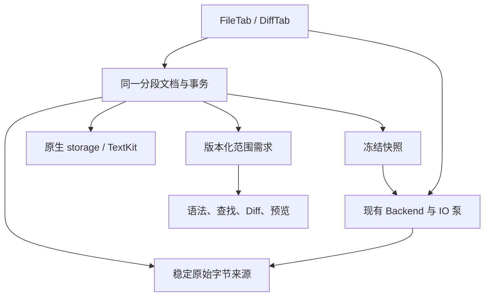

# 把 VS Code 的成熟机制接入 Bailey

这份设计面向实施者：回答每个机制为什么有用、现有代码在哪里、
应该改哪条链、什么必须删除，以及怎样证明收益。
上游事实和限制详见 [源码研究](vscode-source-study.md)；
这里集中维护迁移决定，任务与验收仍归 [P1](plan-p1.md)、[P2](plan-p2.md)、[P3](plan-p3.md)。
所有“接入决定”都是待实现设计，不是本轮性能实测或已交付能力。

## 结论与源码基线

Bailey 应吸收的是一整套相互配合的机制：
**分段正文、原子范围事务、可恢复的内容身份、位置锚点、便宜且可保留的快照、
按范围失效、可见工作优先、流式 IO 与发布事务、分层 Diff 和性质测试。**
它们共同切断“输入一个字，后面却重读、重算、重建全文”的链。
仅换成 Piece Tree 或增加缓存不会自动得到这些收益。

原生 NSTextView／TextKit 2、严格编码与原始字节、单份可写正文、
真实任务取消和保存保护继续是 Bailey 的基础。
上游哪些机制已实现、哪些地方只留了调用或 TODO，要逐字区分；
特别是 Diff 的 `applyOriginalEdits/applyModifiedEdits` 当前是空实现，
不能作为已经实现增量映射的依据。

本次续查固定 GitHub HEAD：
[`15f8b54d0d15b89ca885e2aa87800848a53050f6`](https://github.com/microsoft/vscode/commit/15f8b54d0d15b89ca885e2aa87800848a53050f6)，
提交时间 **2026-11-12 10:00:41 UTC**。
与首轮 `530b702bc1ecca912e842e906fa67ecfc60c091e`
的 [GitHub compare](https://github.com/microsoft/vscode/compare/530b702bc1ecca912e842e906fa67ecfc60c091e...15f8b54d0d15b89ca885e2aa87800848a53050f6)
只有两次 distro 更新：唯一修改是 `package.json` 的 `distro` 值。
本页引用的 `src/`、`extensions/` 和测试与已读取的缓存逐字相同，
全部新增上游链接固定到上述新 SHA；首轮报告保留其可复核的旧 SHA。
没有把随时移动的 `main` 当永久证据。

Bailey 续查起点为本地 `a4abbc1f`；
本页所讨论的正文／IO／Diff 实现与首轮 `6a8ffc4e` 相同。
与本任务并行的 Git panel 改动不属于本设计的修改范围。
本轮只更新研究与计划，没有运行 VS Code、GB 压测、原生实验或产品构建。

## 最小架构：沿现有所有者把链打通

`FileTab`／`DiffTab` 各自拥有标签的文档、草稿、来源和关闭保护；
同路径的两个独立草稿不能被全局缓存偷偷合并。
文档负责正文版本、片段、坐标、编辑和快照；
原生 storage 只把这份文档暴露给 TextKit，不拥有另一份可写文本。
`WorkspaceBackend` 两个实现负责稳定来源与 IO，既有进程泵负责传输。
语法、搜索、Diff、预览和几何是这些版本的消费者。

不新增全局 DocumentManager、SaveService、JobManager 或另一套 Diff engine。
候选类型名不构成必须新增文件的要求；
每个新增职责必须替换一个真实的旧所有者或全文旁路。

### 一次编辑必须交付什么

这里定义数据与顺序，不预建一个通用事件总线：

1. 输入在旧 revision 上形成明确的 UTF-16 替换范围集合，带方向／选区语义；
   自控多光标操作保留原始范围，不从 AppKit 聚合后的包围区间重建中间巨串。
2. 先校验范围、重叠和当前版本，准备可撤销的片段引用；
   同一事务内更新片段、各自单位的坐标摘要和必要锚点。
   逆序写入只是坐标技巧，不改变用户动作的逻辑次序。
3. 事务完整后更新内容历史身份与单调 revision；
   同一原子 batch 的原生变更与业务范围通知保持一个提交边界。
   IME 每次实际修改正文的候选更新才提交、推进正文 revision 并通知；
   仅选择／标记范围变化不伪造文本编辑，整会话按原生行为合成至多一条可撤销历史项；
   不能把分属不同中间版本的范围当作同一 baseRevision 批量排序。
   消费者收到有序范围、前后版本与长度差，不再回取全文确认发生了什么。
4. 高亮、查找、Diff、预览和几何只失效相关范围；
   后台任务持有明确版本，发布前检查文档、来源、编码及请求代次。
   同时取消不再有使用者的旧 producer，而非只丢结果。
5. 保存冻结一个明确版本并迭代片段；
   新输入继续留在当前文档，旧保存完成只能确认其冻结版本。
   改动不能绕过现有关闭、Git 操作前保存和远端目标保护。

### 身份与单位必须分清

| 数据 | 最小含义 | 不能被拿来证明什么 |
| --- | --- | --- |
| 单调 revision | 每次正文事务、Undo／Redo 后前进，拒绝旧异步结果 | 不能单靠“有编辑”断定原始字节必然不同 |
| 内容历史身份 | 同一历史内容状态可由 Undo／Redo 恢复 | 手工改回不自动共享身份；编码／BOM改变也不由它覆盖 |
| 已保存版本 | 已确认发布的内容身份与编码／BOM及目标身份 | 未确认发布、只完成编码、只收到 EOF 都不能更新它 |
| 来源／目标身份 | 机器、连接、路径、稳定来源版本或 Git OID | FD、路径字符串、mtime＋size 不自动等价于不可变内容 |
| 原字节偏移 | 所选来源／编码里的 byte offset | 不能当作 UTF-16 offset；不同编码长度可不同 |
| 编辑位置 | 当前文档中的 UTF-16 code units 及亲和性 | 不能当作字素、视觉列或 Git LF 行 |
| 行摘要 | 明确区分原生分隔规则、Git LF、parser 行列单位 | 不能把三个消费者的“行”合成未经区分的一个数 |
| 几何代次 | 某次折行／字体／折叠／viewport 布局状态 | 不能用旧像素坐标恢复新布局，也不能替代文本版本 |
| Diff 身份对 | 两侧稳定内容、比较选项、算法与来源转换 | 不证明 raw worktree 与 canonical Git 内容相同 |

Bailey 的 Tree-sitter 现有输入使用 UTF-16；
`TextCoordinateIndex.point` 的列是 UTF-16 偏移差乘 2，不能写成 UTF-8 byte column。
同一片段树可以提供多种摘要，不能因此合并语义。

新增片段应允许尚不能按目标编码无损输出的草稿，
保持当前“允许编辑、保存时明确拒绝有损转换”的行为。
不能为让 byte length 随时可知就拒绝普通输入；
未知长度／相等性明确为未知，不能伪装成零或已相等。

### 空间预算覆盖整个版本生命周期

固定的内存预算约束的是**唯一仍驻留的数据**：
原字节与解码页、片段／索引页、未落盘新增文本、Undo 与快照保留的内容、
语法／Diff 结果、算法工作区、IO 排队字节和原生视图额外持有。
共享同一页不重复计费，但旧快照保留的不同内容不能消失在账外。
页数上限只有在页的最大实际尺寸已知时才等价于字节上限。

磁盘 backing、Undo 溢写和外存索引可以随输入与编辑历史增长，
必须有生命周期、空间预检、失败处理与清理归属。
临时磁盘 O(N) 不等于常量空间；系统页缓存、allocator 保留及 Git／SSH 子进程
也不能从进程足迹报告里删掉。
没有必要为了这些数字创建一套运行时监控框架；
优先扩展实际 owner 的测试计数和现有性能测量入口。

缓存淘汰、降低预取、暂停字符细化可以释放可再生数据；
正文、未保存编辑、Undo 或在途保存必须保持其承诺。
预算不足时反馈明确资源失败或对应派生能力未完成，
不能删历史、截断保存或把未比较区域当成相同。

## 机制索引与实施归属

下表与后续 M／R／I／D 章节一一对应。
“复用”表示当前已有基础；“扩展”表示按新分页／版本契约补齐；
“替换”表示接入时必须删除所列全文路径。

| 章节 | 机制 | 主要收益 | 任务 |
| --- | --- | --- | --- |
| [M：文档与事务](#model) | M1～M8 | 局部编辑不平移全文；范围事件、Undo、脏状态、快照共用一个版本 | P2-T1／T2／T3 |
| [R：呈现与调度](#render) | R1～R7 | 无关变化不重算；可见范围先满足；后台不积压；阅读位置稳定 | P2-T3／T5 |
| [I：IO 与生命周期](#io) | I1～I9 | 转换／传输有界；保存合并且完整发布；关闭与取消真正收敛 | P2-T1／T2／T4／T5 |
| [D：Diff 与投影](#diff) | D1～D9 | 精确覆盖与可读展示兼顾；结果可复用；投影不生成三篇全文 | P3-T1／T2／T3 |

## M：文档、事务、坐标和输入

### M1 子树摘要：消除结构编辑后的全篇重建

#### 上游实际机制与调用链

`TextModel.pushEditOperations → EditStack.pushEditOperation → TextModel._doApplyEdits
→ PieceTreeTextBuffer.applyEdits → _doApplyEdits → PieceTreeBase.insert/delete`。
位置查询则从 TextModel / TextBuffer 委托给 PieceTreeBase，
利用节点的左子树文本长度 `size_left` 与换行数 `lf_left` 下探，
不为文首插入平移所有后续行的绝对 offset。[MA01] [MA12] [MA13] [MA34]

修改某个 piece 后，`updateTreeMetadata` 沿父链前进；
当前节点属于父节点的左子树时，累加长度与换行差值到父节点摘要。
因此局部长度变化只更新祖先汇总；不是重算全篇前缀数组。[MA02]
跨 piece 的 CR/LF 还由 `validateCRLFWithPrevNode/NextNode → fixCRLF`
调整两端 piece 并建立一个 CRLF piece，避免两个片段各自计一次换行。[MA03]
这是“结构摘要＋连接边界规则”的组合，不能只移植一棵平衡树。

#### Bailey 的具体接入

现有 `NativeTextLineIndex.replace`（Bailey/Editor/NativeTextLineIndex.swift:58–100）
已只重扫受影响行及相邻边界；行数不变时对 Fenwick 做点更新，
**行数变化时仍 replaceSubrange 并重建整个 PrefixSums**。
`TextCoordinateIndex.replace`（Bailey/Editor/TextCoordinateIndex.swift:30–61）
也在 LF 行数变化后重建完整 prefix tree。普通局部编辑优化已有，不再作为新功能重做。

最小契约是把两者的底层存储改为同一文档片段的有界摘要：
已知原字节长度、已知 UTF-16 长度、parser LF 数、
原生行边界信息及连接两片时所需的首尾分隔符状态。
每个字段必须带明确单位与“已知／未建立”状态；未知不得表示成 0。
页内局部索引留在页预算中，父节点只保存可组合的摘要。
新增文本允许暂以 UTF-16 片段存在；不能要求每次键入都已能按目标编码无损编码，
否则会错误改变“允许编辑，保存时拒绝有损编码并保留草稿”的现行契约。

**共享底座，不合并语义。**
`NativeTextLineIndex(.native)` 目前调用 NSString.getLineStart；
`.gitLF` 和 TextCoordinateIndex 仅把 LF 作为行分界。
TextKit 的行／段落语义、LS／PS，以及 parser 的 LF 行必须分别保持，
不能共用一个未经区分的 lineCount
（NativeTextLineIndex.swift:157–190；TextCoordinateIndex.swift:24–61）。
由文档所有者提供摘要；保留两个实际消费者需要的查询适配，
删除两套常驻全文 lineLengths 数组和结构变化后的全量重建，
不额外建立第三个“总索引 Manager”。

#### 迁移的具体断言

上游 `prefix sum for line feed / insert` 把文本
`a\nb\nc\nde` 在 offset 7 插入 `fh\ni\njk` 后，
同时检查 lineCount=6、多个 getPositionAt/getOffsetAt 互逆和树摘要正确；
`assertValidNode` 递归重算左子树，断言其 size／LF 数等于节点缓存。[MA05] [MA06]
`centralized lineStarts with CRLF` 单独覆盖删除跨 CRLF 的片段。[MA07]

Bailey 扩展现有
`TextCoordinateIndexTests.testNativeLineIndexHandlesBoundaryJoinsAndRandomEdits`
（BaileyTests/Editor/TextCoordinateIndexTests.swift:8–66），
让同一组编辑分别跨源片段、页、已淘汰页：
每步核对原字节、所有适用坐标与摘要；
在长文档文首增删换行时计数实际更新节点／读取页，证明没有再创建全文行数组。
原生 gutter 与 parser 两组 oracle 分别执行，不能拿一个行数互相自证。

**不照搬：** 红黑树颜色、每个 buffer 常驻的 lineStarts 数组不是产品要求。
树型由 P1 实测选择；原生总长度尚未知如何工作，仍须实际证明。

### M2 坐标验证：一个范围必须先说明属于哪个空间

#### 上游实际机制与调用者

`TextModel._validateEditOperation → validateRange`；
`getOffsetAt → _validatePosition → buffer.getOffsetAt`。
`validatePosition` 对界外位置归约到已知模型内；
若位置落在高低代理对中间，则移到代理对前。[MA08]
`validateRange` 对非空范围向外扩展以包含完整代理对；
对空范围只移动，不把插入点变成非空选择。[MA09]

这解决“按 UTF-16 寻址，却意外只替换一个代理项”的问题，
并明确区分光标位置与替换范围。
这里的模型坐标仍不是文件字节，也不是完整 grapheme 分割规则。

#### Bailey 的具体接入

`TextCoordinateIndex.point(at:)`（Bailey/Editor/TextCoordinateIndex.swift:24–27）
已拒绝界外 offset，并返回
`Point(row: LF-row, column: (offset - lineStart) * 2)`。
这个 column 是 **UTF-16 字节列**，不是 UTF-8 byte column。
原生 NSTextView 的 NSRange 则按 UTF-16 单元；
原始 UTF-8／GB18030／Shift-JIS 文件还需要另一套字节边界。

最小契约是在文档范围 API 中区分：

- 已选编码的原始 byte range / 解码检查点；
- UTF-16 范围及其 base revision；
- 原生行查询；
- parser LF row ＋ UTF-16-byte column。

这是参数与返回值的语义契约，不强制为了四个名字增加四层协议。
从 native range 到原始字节的转换只落在已验证检查点和有界局部解码；
不把 UTF-16 offset 直接交给 seek。
对于未建立的全局位置，返回需要补齐索引／取消／失败，不把当前前缀末端当全局 EOF。
UI 的合法位置归约由 AppKit 适配维持原生行为；
文件／远端协议的非法负数、溢出、未知位置则不能复制 Monaco 的静默 clamp。

替换的是 `NativeTextLineIndex` 与 `TextCoordinateIndex`
各自以完整 NSString/String 为前提的坐标来源；
保留 parser 和 AppKit 各自对坐标单位的要求。

#### 迁移的具体断言

上游对 `a📚b` 的一基坐标验证：
position(1,3) 归约为 (1,2)；
空 range(1,3→1,3) 归约为空 range(1,2→1,2)；
非空 range(1,2→1,3) 扩为 (1,2→1,4)。[MA10] [MA11]
Bailey 用这组输入覆盖代理对恰好跨页、跨原始片段及插入片段的情况：
数据转换不得只切半个代理对；位置和替换范围不能互相混用。
具体 UI 归约结果与系统 NSTextView 对照，不强行套浏览器行为。

继续复用
`testLFByteColumnsAndReplacementBoundariesMatchParser`
（BaileyTests/Editor/TextCoordinateIndexTests.swift:354–369）
及 `testGutterParagraphNumbersMatchNativeSeparatorsAndCRLF`
（BaileyTests/Editor/NativeEditorLayoutTests.swift:140–155），
分别验证 LF/parser 与原生分隔语义，新增字节检查点往返断言。
原有随机编辑对照无需另造测试框架。

### M3 批量事务：保留原始范围集合，而不是只剩一个大包围范围

#### 上游实际机制与调用链

`CommandExecutor._innerExecuteCommands` 收集命令操作、处理冲突光标，
交给 `TextModel.pushEditOperations → EditStack → TextModel._doApplyEdits`。[MA51] [MA14] [MA34]
PieceTreeTextBuffer 对**同一编辑前版本**的 ranges 先升序排序；
相接允许，真正重叠在修改正文前抛错；
再生成反向范围和被替换文本，最后降序应用，
避免后面的地址被前面的插入移动。[MA12] [MA13]

正文修改后，TextModel 先让 decorations 接受全部替换，
再增加 version 并通知消费者，监听者读取到的范围已更新。[MA15]
外层用 `beginDeferredEmit/endDeferredEmit` 合并通知。[MA16]
**合并不等于把所有坐标改成一个初始版本。**
`InternalModelContentChangeEvent._mergeChangeEvents` 按顺序连接 changes，
保留各 reason 对应的 change 数，取最后的 versionId。[MA17]
因此跨顺序事务的 changes 不能重新全局排序后重放。

#### Bailey 已有与真正要补的地方

`NativeCodeTextView.insertAcrossSelections`
（Bailey/Editor/NativeCodeTextView.swift:257–293）
已经排序、拒绝重叠、从后向前修改，并用一个 NSTextStorage editing 事务
和一个 UndoManager group。应复用，不能声称 Bailey 还没有多范围事务。

余下的实际成本在
`processStorageEdit`（同文件:745–791）：
它从 `storage.editedRange` 再读取整个 replacement String。
对于相距很远的自控批量编辑，若 AppKit 合并为包围范围，
这一读取会包含巨大未修改间隔。
这是由现有代码识别的**待原生计数验证路径**，本轮未运行 AppKit 来宣称已复现其峰值。

最小提交契约：

`EditBatch(baseRevision, orderedEdits, inputOrigin, beforeSelections)`
→ 完整校验
→ `CommittedEdit(fromRevision, toRevision, forwardRanges, inverseRanges, afterSelections)`。

每个 edit 包含旧版本的 UTF-16 范围与 replacement 片段引用；
inverse 包含新版本的范围与 preimage 片段引用，不只是两个裸范围。
同一 baseRevision、明确的等位置输入顺序、允许相接／拒绝重叠，
是批量操作的不可变前提。
自控多选区／Find Replace All／离屏追加保留原始范围集合；
提交后各消费者逐范围更新，不从一个包围范围重新提取中间正文。
数据面仅存在一个提交 owner；原生 didProcess 回调通知结果，不再次应用同一 transaction。
原生自发输入仍由现有 NSTextStorage 入口归入该 owner，不另建第二个可写缓冲。

迁移 `onCharacterEdit(previousRange,replacement)` 的实际消费者
（SourceTextEditor.swift:269–275、350–362），
删除“为了辨认一次自控编辑，丢掉原始范围后再从合并后整范围恢复”的链。
前置通知缺失时的正确性回退仍须保留，改成有界快照／范围校验，
不能简单去掉保护。

#### 迁移的具体断言

上游同位置依次插入 a、b，结果必须是 `abhello world`；
相接替换得到 `HEllo world`；重叠替换抛错。
共用测试还验证应用 inverse 回原文、inverse 的 inverse 等于原操作，
以及增量 mirror 与主模型一致。[MA18] [MA19]

Bailey 扩展
`testNativeMultipleSelectionsShareDocumentAndUndo`
（BaileyTests/Editor/NativeEditorCompositionTests.swift:414–434）及
`testMountedNativeMultipleSelectionsPreserveBytesDirtyStateAndUndo`
（BaileyTests/Files/FileTabPersistenceTests.swift:1440–1482）。
增加两端远距编辑、同位置插入、重叠拒绝：
最终原字节、Undo、选择、事件重放一致；
失败时正文／revision／Undo 全不变；
自控小 edit[] 不读取中间巨大未改区。
小输入测试可有独立简单字符串 mirror，生产不得常驻全文 mirror。

**不照搬：** Monaco 达到大量 edits 时拼整个跨度的归并，以及完整 oldText 数组。
海量替换的 journal／逆操作允许分页或临时磁盘，逻辑上仍是一条事务。

### M4 revision、历史状态与原字节身份必须分别保存

#### 上游实际机制与调用链

`_increaseVersionId` 同时递增 versionId 并把 alternativeVersionId 设为新 version。
Undo/Redo 继续产生新 version，却在
`_applyUndoRedoEdits` 中把 alternativeVersionId 覆写为历史条目保存的状态 ID。[MA20] [MA21]
`SingleModelEditStackData` 保存 before/after alternativeVersion、
前后 selection 和 EOL。[MA22]

实际文件消费者
`TextFileEditorModel.onModelContentChanged` 把 alternativeVersionId
与 bufferSavedVersionId 比较，识别 Undo 返回已保存状态；
`updateSavedVersionId` 记录当前历史 ID。[MA23] [MA25]
保存完成另用捕获的 versionId 判断能否清除 dirty，
防止保存过程中产生的新编辑被旧完成事件清除。[MA24]

收益是：**已知回到同一个历史状态可以常数成本证明干净。**
它没有证明“两个不同历史 ID 一定有不同字节”；
手工删除再键回同文，不能只因版本不同永远保持 dirty。

#### Bailey 的最小状态契约

Bailey 已有 `recordNativeReplacement`、
`refreshDirtyState`（FileViewerView.swift:279–340）：
UTF-16 频率差异仅用来证明不相同，精确逆编辑可快速恢复 clean，
不确定时用 `hasIdenticalBytes(text,savedText)`。
保存中还重定位 baseline，已有正确性不能删掉。

应把状态明确分成四件事，仍归 FileTab／同一文档所有者：

1. **transaction revision**：内容变更、Undo、Redo 都前进，用于拒绝过期任务。
2. **history state ID**：Undo/Redo 可返回；只表示同一已知内容状态，不是全局内容哈希。
3. **saved byte identity**：成功发布的冻结版本，加编码／BOM等写出语义；
   即使当前已继续编辑，也记录实际写出的那个版本。
4. **source/target identity**：机器、连接、路径／稳定源代次。
   内容相同不能授权写另一目标；正确目标也不能证明正文相同。

同历史状态且写出语义相同时可直接 clean。
不同历史 ID 的手工改回，沿用精确语义：
稳定片段相同部分可跳过，剩余内容做有界的原编码字节比较；
比较结果带 revision 和保存基线身份，过期结果不能清除新草稿。
哈希／频率可以筛除不等，不能独自证明相等。
不能编码的新草稿依然可编辑，保持 dirty，保存时报告错误。

因此删除 `savedText` 的全文字符串基线和仅为相等判断读取 `file.text` 的链，
替换为保存快照身份＋有界精确比较；不把原有“手工改回可 clean”缩水为版本比较。

#### 迁移的具体断言

上游 issue #90973 明确检查：type Hello 后 Undo，
versionId 与初始值不同，alternativeVersionId 与初始值相同。[MA26]
文件测试分别验证 Undo 到保存态 clean，
以及 resolve 到新磁盘内容后 Undo 回旧内容应 dirty。[MA27]
后者迁移的是“保存基线换代不可误清 dirty”的断言，
不新增 Bailey 跨外部重载的 Undo；同字节刷新复用、不同内容退役旧文档的既有契约仍保留。

Bailey 继续执行已存在的
`testNativeReorderAndInFlightSaveKeepExactDirtyBytes`
（FileTabPersistenceTests.swift:1754–1795）：
abc→bac；保存 bac 在途时手工改回 abc，先相对旧基线 clean，
保存 bac 成功后又应 dirty；第二次保存 abc 才 clean。
再沿用
`testCanonicalEquivalentNativeReplacementUndoAndSavePreserveBytes`
（同文件:1797–1836）的 NFC／NFD 非同字节断言。
分页后增加“相同历史ID但编码/BOM改变”及“同内容不同机器／source generation”用例。

### M5 Tracked ranges：把边界如何移动写进范围本身

#### 上游实际机制与调用者

`oneCursor._updateTrackedRange` 将 selection 注册为 tracked range；
`TextModel._setTrackedRange` 管理其 ID、offset 和 stickiness。
编辑时 `TextModel._doApplyEdits → decorationsTree.acceptReplace
→ IntervalTree.acceptReplace → nodeAcceptEdit` 调整边界，
随后光标可以从 markers 恢复。[MA32] [MA28] [MA15] [MA29] [MA30]

四种粘性不是装饰细节，而是在边界插入时的明确语义：

| 非空范围 [0,5]，插入一个单元 | 两端可增长 | 两端不增长 | 仅起点可增长 | 仅终点可增长 |
| --- | --- | --- | --- | --- |
| 在起点插入 | [0,6] | [1,6] | [0,6] | [1,6] |
| 在终点插入 | [0,6] | [0,5] | [0,5] | [0,6] |

上表直接来自 `intervalTree.test.ts`，不是推测。[MA33]
结构上只取出直接相交节点更新，
非相交后缀利用 delta 平移及 maxEnd 剪枝，
避免每键遍历所有标记。[MA29] [MA31]

#### Bailey 的最小接入

当前选择由 NSTextView/TextKit 2 所有，
`EditorState`（Bailey/Editor/SourceTextEditor.swift:7–11）
只持久化 selectionLocation/Length 与滚动值。
保留这个所有权；不能因为借鉴 tracked range 再维护一份相竞争的全局选择状态。

分页后真正需要跨版本存活的对象——例如页外选择端点、异步 Find 定位、
未挂载时恢复锚点——只保存
`documentIdentity + baseRevision + UTF16 endpoint(s) + edge affinity`。
端点更新由同一文档事务做一次；
当前挂载选择仍由原生适配接受／回传，不能由业务反向遍历控件树决定状态。
老版本结果可以用已保留的变更变换到当前版本，或明确失效并重算，
不能只把旧 offset clamp 到现文档长度。

替换的是跨页／异步消费者各自保存裸 offset 并自行平移的路径；
不替换 AppKit 原生选区导航或新造 FocusManager。
只有数量和性能证据要求时才用 interval tree；
少量锚点可先用同一批量变换函数，不能为名字引入 VS Code 全套 decoration 服务。

#### 迁移的具体断言

直接移植上表，以及 collapsed range [0,0]：
AlwaysGrows 插入后 [0,1]，NeverGrows 为 [1,1]；
forceMoveMarkers=true 时四种都变成 [1,1]。[MA33]
对 Bailey 的实际选区、Find 范围、恢复锚点分别选择并记录正确 affinity，
在页边界、Undo、范围全删后验证，不把所有消费者硬套同一种。
再结合现有多选区保存测试，检查范围转换不会改变原字节或丢失第二个选择。

### M6 Undo：组合文本变化，同时保留前后选择与历史身份

#### 上游实际机制与调用链

`TypeOperations → EditOperationResult` 指定事务前／后是否建立 Undo stop。
`CursorsController._executeEditOperation` 按该决定调用 pushStackElement；
`EditStack._getOrCreateEditStackElement` 仅在当前条目可 append 时追加，
否则创建新条目。[MA36] [MA34]

连续编辑经 `SingleModelEditStackData.append → compressConsecutiveTextChanges`，
把前后编辑映射到同一个“原状态→最终状态”关系，合并接触变化并去掉 no-op，
而不是把每个中间替换都永久保留。[MA22] [MA35]
Undo 调用 `model._applyUndo(changes,beforeEOL,beforeVersionId,beforeCursorState)`；
事件携带 resultingSelection，聚焦编辑器恢复指定选择，
非聚焦场景用 tracked markers 恢复，避免另一个编辑器被强行抢光标。[MA37] [MA21] [MA38]

#### Bailey 的具体接入

现有 `documentUndoManager` 必须保留，
`replaceDocumentText`（NativeCodeTextView.swift:97–107）、
多选区 group 和
`finishComposition/replayComposition`（295–369）已经接入。
不要再建立一个与系统菜单 Undo 并行的历史管理器。

最小历史条目记录：
前后 history state ID、原操作／逆操作的片段引用、
前后全部选择（包括方向／affinity），以及确实被本操作改变的编码／换行信息。
正文模型负责片段和版本，现有 UndoManager 只分组、调用它并维持原生操作节奏。
输入合并规则沿用 AppKit 可观察行为；上游“空格／删除换向如何分组”只是可研究的机制，
不能未经需求把 VS Code 的键入节奏强加给 Bailey。

替换旧闭包捕获的大范围 old/new String 为可共享／可落盘片段引用；
composition 历史中的每个范围属于各自的中间版本。
模型数据回放按原顺序在临时版本预检，或先正确组合成同基准映射，
再原子发布本次 Undo／Redo；不得把混合版本的 ranges 直接排序后交给 M3。
候选更新实际修改正文时才提交、推进正文 revision 和通知；仅选择／标记范围变化不制造空编辑。
整个会话按原生行为合成至多一条可撤销历史项，无实际可撤销变化不制造条目。
保留 AppKit 暂态处理、现有回滚保护和正确选择恢复；
只有新文档层能提供等价的完整预检与原子提交时，才删除被替代的数据回放路径。
不为临时片段建立跨重启恢复产品；真正关闭时释放本次历史资源。

#### 迁移的具体断言

上游 `assertCompression` 同时验证：
两批顺序编辑的结果等于压缩后一次编辑，
压缩条目的逆操作可恢复**最初**正文。[MA39]
Bailey 用相同独立小输入 oracle 对跨页插入、删除、重叠的连续会话验证双向等价，
不能只比较最终正向内容。

上游 issue #118041 对 offset 428 删除 U+FEFF 的历史条目做 serialize/deserialize，
同时核对文本、前后版本与选择。[MA40]
Bailey 的 spill/restore 必须保留正文里的 U+FEFF，不能误当文件 BOM 丢掉；
不能照抄 Monaco 的 UInt32 offset/length 序列化格式。[MA55]
issue #42783 则验证 API 编辑后 Undo 仍恢复原光标。[MA41]

继续复用 Bailey 多选区和挂载保存两组测试；
在现有“文本与 dirty 恢复”的断言上增加全部前后选区／方向，
并令其引用的页被淘汰后再 Undo/Redo。
这样证明的是原生行为保留，不只是新模型独自通过。

### M7 输入会话：平台适配终止在事务入口，不能成为第二个正文 owner

#### 上游实际机制与调用链

`ViewController` 只向 commandDelegate 转发；
`CodeEditorWidget → ViewModel → CursorsController`
再生成范围命令，所有路径最终进入同一 TextModel edit 链。[MA52] [MA53] [MA54] [MA36]
`CursorsController.type` 显式区分 keyboard 来源与程序性输入：
keyboard 按字符通过 interceptor，
其它来源用 typeWithoutInterceptors。
`compositionType` 携带 replacePrevCharCnt、replaceNextCharCnt、positionDelta；
没有文本修改但只有 positionDelta 时只移动选择，不伪造文本编辑。[MA42]

组合更新使用 TypingOther 操作类别，
是否建立前置 stop 由前一操作类别决定，更新后不逐次建立 stop。[MA43]
composition end 才根据最终 outcome 触发相应后处理。[MA42]
正向价值是明确**输入来源、暂态更新、最终历史事务**三者，
不是学习浏览器 EditContext 的整行字符串窗口。

#### Bailey 的具体接入

`setMarkedText`（NativeCodeTextView.swift:224–234）建立现有
CompositionTransaction 并暂时关闭系统自动 Undo 注册；
`shouldChangeText`（205–220）记录真实 preimage 范围，
`processStorageEdit` 记录实际替换结果；
`insertText/unmarkText → finishComposition` 建立一个最终 Undo group。
`finishComposition` 已剔除 AppKit 结束候选时未真正保留的暂态删除。
这些来自 24014251 的行为不重写成全文快照。

最小契约保留一个 composition session ID、起始历史 ID／选择、
有序范围变化及其实际阶段。
marked-text 的实际正文更新立即提交到当前文档并显示；
仅选择／标记范围变化仍由原生状态表达，不为它增加正文 revision。
不把每个候选版本变成独立 Undo stop；确认／取消后无实际可撤销变化则不制造历史项。
确认／取消按 AppKit 最终正文收口；最终提交若指向标记区以外的范围，
也必须包含在同一次实际输入会话中，不能假定只替换 marked range。

输入来源只登记实际消费者需要的 native／IME／paste／programmatic／undo/redo 区别，
用来防止程序性刷新重复进用户 Undo、同一原生事件被反射应用两遍；
不增加通用命令总线、遥测模型或新的自动补全功能。
删除大 composition preimage 的单串持有，改为历史片段引用；
保持 shouldChange 与 didProcess 的实际配对和不匹配时的正确性检查。

#### 迁移的具体断言

上游 issue #9675 把 ｓ→せ→せｎ→せん→せんせい 的连续 compositionType 更新收成一次 Undo：
结果为 せんせい、光标在列5，Undo 后空文档、光标列1。[MA44]
Bailey 将同类候选序列放在页边界、中文／emoji选区、冷页与大删除场景，
一次 Undo 回会话前的完整字节和选择，不在候选中间停住。

已有
`testNativeIMEExposesPrecisePrechangeRangesIncludingUnrelatedCommit`
（NativeEditorCompositionTests.swift:340–384）
会对 NSNotFound、文首显式范围及另一区域的最终提交，
逐步重放实际 pre/post UTF-16 范围并对照原生最终文本。
直接扩展这个真原生测试，不另造脱离 FileTab 的输入模拟器。
真实候选／AX 全文请求是否有界仍由 P1/P2 实测；
这不影响先吸收“局部事务＋会话收口”的机制。

### M8 Snapshot：冻结读者的内容身份，而不是冻结编辑器

#### 上游实际机制与调用者

`TextModel.createSnapshot → TextModelSnapshot → PieceTreeBase.createSnapshot
→ PieceTreeSnapshot`。
PieceTreeSnapshot 在创建时保存当前所有 Piece 引用；
read 根据这些 piece 的原 buffer 范围迭代取内容。[MA50] [MA49] [MA45] [MA46]
`Piece` 的字段为 readonly；
常规插删替换节点中的 Piece，使已捕获的旧 Piece 仍描述旧文本。
因此后续编辑可以继续，读者不必每次重新取当前模型。[MA45] [MA48]

实际保存消费者是 `TextFileEditorModel.doSaveSequential`：参与者完成后重取 version，
调用继承的 `BaseTextEditorModel.createSnapshot`（保留 BOM），
再把 snapshot 交给 `textFileService.write`，最后按捕获版本处理完成状态。[MA56] [MA57]

这提供了一个值得直接吸收的约束：**一个读者必须始终读同一个版本。**
不是“每次 read 都从当前路径或当前 UI 取最新一块”。
保存、比较、编码检查和原字节相等核验都应通过同一类冻结读契约。

#### Bailey 的具体接入与寿命

当前 `FileTab.writeCurrentText`
（FileViewerView.swift:400–445）以完整 `bytes` 和 `written = text` 冻结保存，
然后异步 backend.write；新编辑通过现有增量状态保留。
改变的是冻结成本，不是删除这个一致性。

最小 snapshot 记录：
文档／history identity、捕获 revision、编码/BOM语义、
冻结片段序列的根或分页元数据游标，以及其稳定 source lease。
iterator 只能读这些片段；源读取错误必须返回错误，
不能用正常 EOF 代替。
文档保存新编辑到新版本，快照继续保留旧片段；
page cache 淘汰不等于释放 snapshot／Undo 还引用的 backing。
最后一个持有者结束才回收其独占资源，失败、取消和关闭也有明确释放路径。

替换 `written`、`savedText` 和下游消费者的完整 String 捕获，
接入现有 FileTab 生命周期和保存队列。
源的文件系统稳定性与发布协议仍由现有 backend/session owner 承担；
snapshot 不能自己启动第二套 IO 或把 FD 当不可变源。

#### 迁移的具体断言

上游 `immutable snapshot 3` 先在 abc\ndef 尾部插入一个 !，创建 snapshot，
再插入第二个 !；snapshot 与当前模型应不同。
其它用例验证删掉／重新插入 piece 后旧 snapshot 仍有效。[MA48]
Bailey 把该断言加强为精确字节：
snapshot 始终输出 abc\ndef!，当前文档输出 abc\ndef!!；
在 iterator 已读第一块、后续块被淘汰、继续编辑及源失效时分别核验。
这是对上游测试的明确扩展，不称上游已经证明分页或外部源不变。

继续沿用 Bailey 的在途保存测试：
输出必须完整属于捕获版本，当前新草稿仍 dirty；
回到捕获的保存历史状态时可以 clean。
快照结束后检查旧 backing／临时文件释放，重挂载不得误释放仍活跃文档。

**不照搬：**
Monaco 构建 snapshot 时收集全部 piece，元数据仍 O(piece 数)；
其源码还明确禁止在 snapshot 读取时同时 normalization，
`setEOL` 会重建 buffers。[MA45] [MA47]
Swift 的 actor／线程并行不能照抄 JS 引用时序。
P1 必须选定能共享冻结版本、分页元数据且受预算约束的最小实现，
不在每次保存再遍历并常驻全部 piece 描述符。

## R：呈现、失效与后台调度

### R1 按变化原因传播失效，同一轮只提交一次呈现

**上游已实现。** `ViewEventHandler.handleEvents` 分派内容、tokens、选区、滚动、配置等事件；
各 view part 只有处理器返回 true 才进入 dirty 集合。
`View._scheduleRender` 合并待处理帧，`_getViewPartsToRender` 只取 dirty 部件；
协调器依次执行准备文字、渲染文字、准备其余部件、渲染其余部件。
这既减少重复工作，也把依赖文字布局的测量放在文字阶段之后。[AR01] [AR02] [AR03]

**Bailey 当前。** `RestorableScrollView.scheduleEditorGeometryUpdate` 已用一个布尔位合并主队列几何更新；
`SyntaxHighlightCoordinator` 已把色彩作为临时 rendering attributes，不改正文或 Undo。
`NativeCodeTextView.updateGutter/configureWrapping` 仍有独立调用链，
不能把一次颜色变化扩成全文宽度测量或坐标重建。

**接入决定 — P2-T3。** 保留上述 owner，在现有编辑器内明确四类失效：
正文范围、语法范围、几何范围、仅绘制范围。
字体／折行改变几何；主题只重映射颜色；选区只刷新选区、当前行和 gutter；
滚动只改变可见需求。一次正文事务结束才提交一次原生 change 和相应派生请求。
复用 AppKit 的布局与绘制调度，不增加跨 App 的 RenderingCoordinator、
不为了模仿浏览器而自己建立帧循环。
先核对每个现有回调是否已符合这些关系，删除重复的测量／全量刷新调用。

**可检查结果。** 给原生范围读取、坐标更新、宽度计算、parser 输入和高亮请求分别计数；
单独滚动、切主题、移动插入点时正文 revision 不变，也不产生全文读量。
同一轮多次几何请求合并，保留真实像素、选区、焦点和滚动条位置。
VS Code 的 `RenderedLinesCollection` 测试把视口外变化与命中行变化分别断言，
可迁移其“谁必须失效、谁不得被波及”的性质，而不是复制 DOM。[AR04]

### R2 保留视口重叠部分，缓存必须包含真实依赖

**上游已实现。** `ViewLayer.renderLines → ViewLayerRenderer.render`：
视口完全不重叠才重新创建全部可见行；重叠区更新位置，边缘插入／移除。
`ViewLine.renderLine` 在未标记 invalid 时跳过；
即使被标记，也先比较 `RenderLineInput`，输入未变便复用结果。
ASCII 等宽快路径有明确前提：基本 ASCII、LTR、等宽假设有效、
无 foreign elements、未启用 variable fonts；其它情况走真实布局。[AR05] [AR06]

**Bailey 当前。** TextKit 2 已负责视口片段，现有
`testNativeViewportOnlyMaterializesVisibleParagraphsAfterDistantVisits`
验证远距访问后的可见段落行为。
`NativeMeasuredLineWidths` 已有 ASCII 快路径，Unicode 巨行仍可能整行读取。
因此这里的收益是减少我们额外创建的内容和宽度数据，而不是再造视口虚拟化。

**接入决定 — P2-T3。** 视口语法、宽度和行号数据引用同一文档范围；
重叠范围保留，离开范围的数据按字节预算淘汰。
缓存键至少包含其实际读取的片段身份／revision、范围、字体与度量参数、
折行宽度和所需的语法／主题身份；颜色缓存与几何缓存不混为一份。
编辑仅淘汰受影响片段及确需后继传播的范围，不用全篇 revision
无条件让所有页面缓存失效；不能安全复用时才重新请求。
不把 Unicode、组合字、tabs、比例字体或双向文字纳入未经证明的 ASCII 估宽。
删掉为找“全文最长行”而在首屏扫描所有行的路径，逐步测得的宽度不能冒充完整文档的精确最大值。

**可检查结果。** 重叠滚动只新增边缘工作；远处局部编辑不使当前稳定缓存失效；
字体改变必须使度量失效，主题改变不能重新解析正文。
保留现有长行可点击位置、隐藏尾部编辑、缩放／Dock resize、混合 Unicode 和字体回归。
上游 `viewLayer.test.ts` 对视口前、内部、之后的插删矩阵验证了行对象保留与偏移，
Bailey 在原生片段／页访问层采用对应断言。[AR04]

### R3 失效从受影响位置传播，到上下文收敛处停止

**上游已实现。** `TrackingTokenizationStateStore.acceptChange` 调整状态与无效区间；
`setEndState` 删除本行 invalid 标志，只有新 end state 不等于旧状态时才使下一行失效。
`TokenizationStateStore.acceptChange` 特意保留尾端旧状态，用于编辑后重新识别收敛点。
`RangePriorityQueueImpl` 合并交叠／相邻区间，插删行时移动后续区间。[AR07]

`TokenizerSyntaxTokenBackend.handleDidChangeContent` 更新 token store，
`setTokens` 只发变化行范围。它不是每输入一个字就把后面所有内容都永久视为失效。[AR08]

**Bailey 当前。** 已有 Tree-sitter 增量编辑、Neon 可见高亮和 `highlightRevision`；
但存在 injection 时，`invalidationHandler` 使用 `.all`，
`willChangeContent` 会取消并清空所有 injection 任务。
这是需要细化的实际成本。不能另外移植 TextMate 的逐行状态机，
形成与现有 Tree-sitter 并行的第二个 parser。

**接入决定 — P2-T3。** 沿现有 Tree-sitter `InputEdit`／changed ranges
维护合并后的失效区间，使用它真实提供的上下文／依赖关系判断收敛。
某一 injection 被改动时，仅替换受影响的 fragment；
外层语言、边界或 query 改变时再扩大失效。
页面是 IO 单位，不是语言边界，禁止把跨页字符串或注释独立解析成“准确”高亮。
如果现有 parser 接口不能在预算内提供完整上下文，保留纯文本结果并报告该派生能力状态，
不创建完整 GB 语法树来追求表面上的局部颜色。

**可检查结果。** 原生输入／Undo 后，有限夹具的当前 tokens 必须和 fresh parse 一致；
跨页注释、插入换行、删除 injection 边界、同长度修改、语言切换均覆盖。
未变化的其它 injection 不被重复解码，跨上下文变化不能过早停止失效传播。
复用 `NativeSyntaxHighlightingTests` 的
`testEmbeddedSameLengthEditLanguageRemovalAndUndoKeepCurrentColors`、
`testQueuedSemanticEditAndEarlierInsertionRecolorCurrentViewport` 等；
新增断言是受影响范围和读取量，而不是重做已有正确性。
上游 `textModelTokens.test.ts` 的区间合并、缩短、平移与清空测试提供直接的区间性质模板。[AR09]

### R4 可见请求优先，后台工作以可中断批次推进

**上游已实现。** `refreshAllVisibleLineTokens` 合并已附着视图的可见范围，
优先为它们准备 tokens；尚无准确前序状态时可以猜测状态，随后重新请求准确 tokenization。
`DefaultBackgroundTokenizer._isScheduled` 合并尚未执行的 idle 调度；
每批执行前检查 disposed、attached 和剩余工作，再以 idle deadline／`setTimeout(0)` 续跑。
标志进入 idle callback 时就清零，因此它不保证整个续跑生命周期只存在一份排队任务。[AR08] [AR10]

源码的“至少 1 ms”循环只在行与行之间检查耗时，
不能据此承诺一个超长行也在 1 ms 内结束。
猜测 tokens 也不是可靠语义，不能成为保存、折叠正确性或代码操作的依据。[AR10] [AR11]

**接入决定 — P2-T2／T3。** 在现有文档／高亮任务内按
当前输入及可见范围、邻近预取、其余扫描排序；
保存和查找显式请求提升对应范围需求，关闭或换源撤销旧需求。
后台索引、解码、高亮和 Diff 字符细化都要在真实生产循环中有取消点，
并限制单批输入字节、输出字节和待处理任务数。
某个第三方 parser 无法中断的调用必须单独测最坏工作量；
不能把“运行在后台”写成资源已经受控。
脱离可见视图时停止可丢弃的视觉预取；保存、来源校验和关闭保护按其真实事务继续，
不能用“无视图”一刀切取消业务工作。

**可检查结果。** 主线程热输入不等全文后台扫描；
连续滚动只保留最新可见需求及有界邻域，旧工作实际结束。
无视图时色彩预取停止，保存中的完整性校验仍能完成。
记录单批最坏耗时、处理字节、排队字节和取消后继续处理量；
时间片上限与算法不可中断区间分别报告，不用平均耗时掩盖巨行停顿。

### R5 用内容位置加像素偏移保持阅读位置

**上游已实现。** `StableEditorScrollState.capture` 记录首个可见位置
与该位置相对视口的像素偏移；`restore` 在布局变化后重新取得该位置的 y 并恢复偏移。
另有相对光标、以最后可见行底缘为锚点的形式。
这个 helper 本身不负责将旧文本坐标穿过任意编辑映射。[AR12]

**Bailey 当前。** `RestorableScrollView` 已处理重挂载、查找栏 inset、
布局后 clamp 和滚动条更新；其主保留值还是像素 origin。
在延迟页高度逐渐确定、折行改变或 Diff 折叠展开时，
相同像素 y 未必仍表示原来阅读的正文。

**接入决定 — P2-T3，Diff 扩展见 [D7](#d7)。** 扩展现有 scroll owner，
捕获“文档内容锚点＋所在原生 fragment 内像素偏移＋几何代次”。
锚点通过同一次编辑事务转换，几何变化后再由 TextKit 定位；
已发生新用户滚动／新布局代次时，不让旧恢复任务抢回视口。
保留现有查找栏、重挂载和水平滚动补偿，避免两个恢复器连续覆盖。
巨行横向定位需独立原生测量，不能把上游垂直 helper 当作横向问题已解决。

**可检查结果。** 在冷页补齐、估计高度修正、折行切换、前方插删、
大块折叠展开和 Dock resize 后，读者仍看到相同内容与可解释的偏移。
锚点内容被删时按预先规定的前／后邻边界落点，不能跳到旧行号或产生空白。
复用 `testSourceRestoresScrollSelectionAndResizesWithoutRecreatingDocument`
与现有 Diff 几何测试；新增的是几何／文本版本交错和读取量约束。

### R6 共用昂贵任务的结果，取消按请求所有权传播

**上游已实现。** `OutlineModelService.getOrCreate` 用模型版本及 provider 集合判断复用，
缓存正在运行的 promise。每个请求者参与引用计数；
只有最后一个请求者取消时，才向共享 provider 计算发送取消请求并删除缓存；
生产者何时停止仍取决于 provider 响应 token，
`OutlineModel.create` 传递 token 后仍等待 `Promise.all`，没有强制中断机制。
模型移除也会清理缓存。
它同时记录实际耗时并送给 debounce service。[AR13] [AR15]

这段源码是共享任务的具体样本，不是所有竞态和内存上限的通用证明：
其 LRU 按项数计数，不能直接用于每项可能占用 GB 的数据。
这里也不因此给 Bailey 增加 Outline 或 LSP 功能。

**Bailey 当前。** `HighlightQueryCache.shared` 已共享 grammar query 编译；
`SyntaxHighlightCoordinator` 持有 `SyntaxHighlightTextInterface`，后者弱持有原生 `NativeCodeTextView`。
`deactivate` 取消并清空 injection 任务、断开 adapter 的 textView 引用，再释放 highlighter。
现有“关闭第一个编辑器不影响第二个及 Diff 颜色”的测试已经守住共享边界。

**接入决定 — P2-T2／T3／T5。** 保留现有 query cache；
对页面解码、可见语法、保存快照等真正共享的工作，
先核对是否已有唯一 producer，复用正在进行的同身份请求。
文档退役取消自有请求；最后一个使用者退出才释放共享 producer／backing。
缓存键加入实际 source identity／content identity／codec／范围等依赖，
按唯一驻留字节计费，而不是按“最多缓存 10 页／任务”自称有界。
缓存淘汰只释放可再生结果；Undo、在途保存仍引用的内容不能被静默删除。

**可检查结果。** 同页多请求只发生一次读取；取消一个不影响其它真实使用者；
最后一个退出后 FD、producer、页和临时数据能释放。
编辑或换源以后，即便旧任务成功，也不能进入新文档的缓存或 UI。
不重写已成立的 query 生命周期；只补新分页资源与共享工作的缺口。

### R7 由实际耗时调节可延迟工作，保持输入与保存语义稳定

**上游已实现。** `FeatureDebounceInformation` 按 model 和 provider 身份保存
6 次滑动平均，结果夹在调用方 min/max 之间；
`OutlineModelService` 在真实计算完成后更新观测。
这不是只有一个固定 debounce 常数，也不是按文件字节直接猜机器性能。[AR13] [AR14]

**接入决定 — P2-T3／P3-T2。** 只在现有可延迟的着色、Diff 重算、
索引预取调度中使用有上下界的近期耗时反馈。
先用固定且可解释的 P1 预算建立正确基线，证明确有重复排队／饥饿问题时再启用反馈；
不建立全局自动调参服务。
前台输入、IME 确认、显式保存、关闭保护不能被自适应 debounce 延迟语义。
连续输入期间合并旧派生工作，但用户停止后必须有最大等待边界；
后台持续积压时先减预取和细化，不能悄悄降低正文完整性。

**可检查结果。** 相同负载下比较总 producer 次数、取消浪费、热输入 p95、
停止输入后的最终结果延迟和峰值排队字节。
用受控慢任务证明边界，不以真实 sleep 凑测试。
上游的默认数值、按项数 LRU、开发模式特殊分支均不作为 Bailey 的预算。
只有反馈机制在实际 Bailey 路径上减少工作且没有饥饿，才保留它；否则用已有固定合并。

## I：流式 IO、保存与生命周期

### I1 把编码变成可恢复状态的流，而非每页各自转 String

#### 实现、调用者与解决的问题

[`src/vs/workbench/services/textfile/browser/textFileService.ts`][ADIO03]
的 `readStream / doRead` 调用
[`src/vs/workbench/services/textfile/common/encoding.ts`][ADIO01]
`toDecodeStream → DecoderStream.create → write / end`。
同一 decoder 贯穿全流：UTF-8 `decode(...,{stream:true})` 保留跨块剩余字节，EOF 单独 flush；
其它编码使用同一个 iconv decoder。探测阶段只暂存首批 chunks，异步确定编码时暂停 source，
准备好后消耗这批数据、释放探测数组并继续正文流。
反向路径 `getEncodedReadable → toEncodeReadable` 也只创建一个 encoder，
逐 chunk 消费，结束时取 leftovers；空正文需要 BOM 时单独输出 BOM。[ADIO02]

这个机制解决三个不同问题：字符跨 IO 块不被破坏；异步编码选择不会丢掉已读前缀；
编码器尾部状态与空文件 BOM 不依赖“最后一块恰好非空”。
它不证明完整文档分页；借鉴的是状态协议。

#### Bailey 接入及旧链删除

当前 owner 是 `Bailey/Editor/TextFileEncoding.swift:50–101,151–184`：
`encoded` 生成完整 Data 并做 UTF-16 往返，`decoded` 解完整字节，
`contradictsDeclaration` 先 `Data(text.utf8)` 再截 512 字节／前两物理行。
入口是 `FileTab.readContent / writeCurrentText`，不需要第二个编码服务。

在同一类型增加由稳定源／保存快照持有的**本次转换状态**：
选定 encoding、BOM 是否消费／输出、未完成编码单元、输入 byte offset、
输出 UTF-16 offset、是否正常结束、严格失败位置。
头部探测用实际受限的首 512 字节；mbcs 的远端代码页仍由当前 backend 查询。
顺序扫描使用一个 decoder；随机页必须从可恢复检查点开始或回退到已知字符边界，
不能把任意 byte offset 直接喂给一个全新 decoder。

分页数据源取代 `readContent` 的完整 Data，快照迭代取代 `encoded(text)` 的全文输出；
`contradictsDeclaration` 改为所需前缀访问。严格性保留：
非法 UTF-8 不能采用上游的 U+FFFD 容错；
旧编码仍做逐段但状态连续的无损往返；UTF-16 中零字节合法，真实 U+0000 正文维持现有拒绝策略。
完整源验证状态属于源版本，未改字节直拷也不能跳过。
decoder／encoder 的正常 finalize 与失败／取消分开，失败不能变成成功 EOF。

#### 可迁移断言

[`src/vs/workbench/services/textfile/test/node/encoding/encoding.test.ts`][ADIO04]
把“中”的 UTF-8 拆成 `e4b8 / ad`，检测恰在前两字节发生，仍得到一个“中”；
同时验证检测门槛高于整个文件、空流都能完成。
同文件 [L410–434][ADIO05] 验证 GBK 的 65,537 个字符及跨 chunk 中文正文，
[L466–525][ADIO06] 验证编码与空 readable 的四种 BOM。
其截断 emoji 用例期待宽松 TextDecoder 的结果；Bailey 应保留分片方式，
把期望改成**严格 EOF 错误、保留草稿、目标不发布**。

扩展既有 `BaileyTests/Files/FileTabPersistenceTests.swift` 的
`testExplicitLegacyEncodingsOnlyAcceptLosslessRoundTrips`、
`testWindowsMBCSFileUsesActualCodePageAndSavesExactlyInOriginalEncoding`、
`testUTF8AndUTF16ByteOrderMarksRemainByteExact`。
对每个现有编码枚举多字节边界的全部切点，并加一字节供给、空块、尾部截断、
BOM 分片、不可表示的新字符、未访问尾部非法字节；
断言源 offset、UTF-16 坐标、完整重开字节和发布次数，而不只比较显示 String。

### I2 短 IO、背压和 close 必须由同一个消费序列完成

#### 实现、调用链与解决的问题

[`src/vs/platform/files/node/diskFileSystemProvider.ts`][ADIO09]
`readFileStream → readFileIntoStream → doReadFileIntoStream`，
最终循环位于 [`src/vs/platform/files/common/io.ts`][ADIO07]。
`posInFile / posInBuffer / allowedRemainingBytes` 只按真实 bytesRead 推进；
短读不是 EOF，零字节才结束；一个填满的 buffer 交给 target 后继续；
退出路径在 finally 关闭同一 fd。

保存是 `FileService.writeFile → doWriteBuffered → doWriteStreamBufferedQueued /
doWriteReadableBufferedQueued → doWriteBuffer`，
实现见 [`src/vs/platform/files/common/fileService.ts`][ADIO08]。
每次短写都推进文件 offset 与当前块 offset，直到这一块写完；
流式消费者暂停 source，链式等待本次异步写后再恢复。
`finish` 记录首个错误，并等待最后 `pendingWrite` settle 后才完成，
外层 finally 才 close。这避免“EOF 已到但最后一次 write 仍在执行”时提前释放句柄。

#### Bailey 接入及旧链删除

`Bailey/Workspace/LocalWorkspaceBackend.swift:86–112` 已在一个 FileHandle 上分块读，
但 `data.append(chunk)` 最终持有全文。
`runSync:324–488` 已有唯一 nonblocking poll owner：
同时排 stdout／stderr，stdin 短写按 offset 前进，0 写入转 EIO，
EINTR／EAGAIN 重试，提前关闭输入转 EPIPE。
`ProcessRemoteCommandRunner.run` 正是复用这个 owner，不能重新建写线程。

文件读取应把 chunk 交给有消费确认的有界出口，替换 `data.append`；
文本保存给现有泵一个有界 chunk 来源，替换
`inputData = stdin ?? Data()` 以及文本链累积 `outData` 的操作。
泵只保留当前未写完的 chunk 与 offset；不能在读取下一块前丢弃尚未完成的一块。
成功返回须等内容终态、最后写入、句柄关闭／所属命令退出；
错误收尾也等在途 IO settle 后释放资源。把 zero-progress、预期长度内提前 EOF
作为明确失败，不能照搬上游没有零进展防护的短写 while。
最终长度、内容 digest／逐字节比对和发布资格分别检查。

#### 可迁移断言

[`src/vs/platform/files/test/browser/fileService.test.ts:692–844`][ADIO10] 的测试并不只检查结果：

- `buffered stream serializes buffered chunks and completes partial writes` 将每次写入限制为 2 字节；
  期望调用依次为 `(pos,offset,length)=(0,0,3),(2,2,1),(3,0,4),(5,2,2)`，
  `maxActiveWrites=1`，最终 `abcdefg`。
- `buffered stream waits for pending writes before closing` 把写入暂停，
  同时枚举 write error／stream error；事件必须是
  `write started → write finished → close`，错误不能被成功 EOF 覆盖。
- 背压测试使用 `highWaterMark:0`，三块生产者每次都实际 await，
  最后写入 `onetwothree`，既不死锁也不合并为全文。
- [失败后释放写队列][ADIO11] 验证后续保存仍能运行。

这些断言迁入已有 `RemoteCommandsTests`／拟定的文件会话测试；
继续复用 `testLocalCommandDrainsLargeStdoutAndStderrWithoutDataLoss`、
`testSuccessfulParentExitCannotHideStalledStdinDescendant` 和关闭 stdin 回归。
新增测试应真正阻塞底层 write／close，并同时填充 stdout／stderr；
断言队列 byte 峰值、短写偏移、关闭顺序及实际磁盘字节，不另建测试进程引擎。

### I3 保存队列合并“请求”，不积累多个完整快照

#### 实现、调用链与解决的问题

[`src/vs/workbench/services/textfile/common/textFileEditorModel.ts:859–938`][ADIO12]
`save → doSave` 先取得 versionId：
同版本正在保存时返回运行中的 promise；
已有运行任务时只 queue 下一次 `doSave`。
[`src/vs/base/common/async.ts:1694–1780`][ADIO14]
`TaskSequentializer` 只有一个 running 和一个 queued：
再次 queue 替换待执行 closure，所有等待者共享该 queued promise。
运行任务成功或失败均会推进队列；旧 taskId 完成不能清除新的 running。

保存参与者可能修改版本，故 [`doSaveSequential`][ADIO13] 在参与者后
重新捕获 versionId、创建 snapshot，再以新版本标记真正的磁盘写入。
其取消只尝试停止准备阶段，不把取消已提交写入当作回滚。
这个组合减少慢磁盘／网络期间的重复准备与排队对象，防止旧写落在新写之后。

#### Bailey 接入及旧链删除

`Bailey/Editor/FileViewerView.swift:379–397` 已把保存串在 `lastSaveTask` 之后，
真正运行时才调用 `writeCurrentText`。这是正确的现有串行基础，
**不是缺少保存保护**；但每次请求仍创建一个 Task 并捕获 preceding，
长保存期间大量重复触发会形成等待链。

将 FileTab 里的普通同语义保存合并为“一次运行＋至多一个最新待运行请求”，
普通可合并请求跟随该轮取得执行权并完成准备后捕获的最新快照，
不承诺逐一发布入队时的中间 revision；所有被合并等待者接收该轮真实结果及实际发布版本，
失败／发布确认未知亦如实返回。显式固定版本、编码变更及文件操作／关闭屏障不能被合并吞掉。
请求键至少区分目标代次、所选编码和动作语义；
显式另存编码等不能合并的动作沿既有串行／mutation 屏障执行，
不能为了一个 pending 槽静默覆盖它们；文件操作／关闭等待也不能提前结束。
只在请求真正获得执行权时冻结快照；被替代的请求不得提前 pin 一个 GB 版本。
删除对应的逐请求 preceding Task 链，保留 `beginFileMutation / endFileMutation`、
`targetGeneration`、保存失败保稿与关闭保护。
`TaskSequentializer` 本身已标 deprecated；移植执行契约，不能引入其 TS 工具类或新全局服务。

#### 可迁移断言

[`src/vs/base/test/common/async.test.ts:1089–1192`][ADIO15]：
`executing and multiple queued (last one wins)` 同时等待三个 queued promise，
前两个 closure 不执行，最后一个执行；`join` 必须等当前和待执行任务。
这些是队列机制断言，不单独证明文件保存正确。

Bailey 已有
`FileTabPersistenceTests.testFocusTriggeredSaveSerializesConcurrentEditsAndKeepsFailures`
（L919–957）：阻塞首次写后改文档，首次完成只能写旧字节、仍 dirty；
第二次写出新字节，失败保稿。
在这条现有用例增加 100 次相同保存请求、在途编辑后的多个版本、
显式编码变化和文件移动屏障：
至多一个 pending 准备任务、最后版本确实发布、所有等待者有终局、
旧结果不能清除新稿，且不丢必须执行的编码意图。
不能只测试“最后一个 closure 跑过”。

### I4 资格检查、准备、冻结、写入、确认各有明确边界

#### 实现、调用链与解决的问题

上游 [`TextFileEditorModel.save`][ADIO18] 在开始昂贵工作前拒绝 readonly，
冲突／错误态的自动保存也不反复覆盖。
`doSave` 在保存前 push Undo boundary；
`doSaveSequential → TextFileEditorModelManager.runSaveParticipants →
TextFileSaveParticipant.participate` 完成有序准备后，再取最新模型版本和 snapshot。[ADIO12] [ADIO13]

[`src/vs/workbench/services/textfile/common/textFileSaveParticipant.ts`][ADIO16]
按 ordinal 排参与者，逐个 await，前后分别 `pushStackElement`；
模型销毁或 cancellation 会停止继续调用。
普通参与者错误记录后继续；参与者主动 CancellationError 可取消保存。
这是编辑器扩展的策略，不是 Bailey 严格编码验证允许忽略错误的理由。
`handleSaveSuccess` 只在保存版本仍等于当前版本时清 dirty，
但保存事件会携带实际成功结果。[ADIO43]

#### Bailey 接入及旧链删除

Bailey 当前没有这些 formatter／code-action save participants，
不需要新增插件钩子、注册表、格式化功能或上游 Undo 后自动保存延迟策略。
可迁移的是**同一 FileTab 保存动作里的事务顺序**：

1. 先核对 readOnlyReason、reloadError、目标身份和当前保存保护；
   不能在明确不可写时先遍历整个 GB 文档。当前 `writeCurrentText:401–416`
   是先完整编码再检查 readOnlyReason，分页迁移应消除这一无效扫描。
2. 完成现有必须的声明／编码资格检查和同步编辑事务收尾；
   不改变 marked text 的既有确认／撤销行为，不擅自增加正文转换。
3. 冻结 `targetGeneration＋documentVersion＋encoding＋稳定源版本`，
   把该快照交给后台严格校验／编码。快照建立后继续输入属于新版本。
4. 写入、发布与确认分开；仅实际成功的同版本结果更新干净基线，
   新稿仍 dirty，保存失败不清 Undo。

将重复全文 `text` 读取、`let written = text` 和全文 `savedText` 换成版本引用与
现有字节相等语义的分页实现；dirty／alternative-version 的具体结构由模型分工维护，
不能仅用递增版本替代“手动改回原字节即干净”。

#### 可迁移断言

[`src/vs/workbench/services/textfile/test/browser/textFileEditorModel.test.ts:684–810`][ADIO17]
`Save Participant` 在回调中将 foo 改成 bar，
保存事件断言实际模型 snapshot 为 bar 且已 clean；
异步参与者用例断言保存完成发生在参与者完成之后；
skip 用例断言未调用参与者。
迁移其**先准备、后冻结、最后通知**的时序断言，不新增参与者产品功能。

Bailey 复用现有严格编码、在途编辑、重命名和关闭回归：
无写资格时 decode／encode／write 计数均为零；
编码失败不进入发布；暂停编码后再输入时磁盘对应冻结版本，新稿保留；
成功通知之前目标完整可重开。准备阶段取消与发布后取消分别测，
不能把两者都断言为“目标未变”。

### I5 合并刷新，并把结果是否仍有效放在发布点判断

#### 实现、调用链与解决的问题

[`src/vs/workbench/services/textfile/common/textFileEditorModelManager.ts:134–197`][ADIO19]
`onDidFilesChange → queueModelReload` 跳过 dirty 模型；
每个 resource 最多保留一次正在运行和一次待运行 reload。
[模型的 `resolve` 入口][ADIO42] 另拒绝普通 dirty／正在保存模型的重读；显式 contents 另走有意替换分支。
[`reload / resolve / doJoinPendingResolves`][ADIO20] 对被跟踪的 pending resolve 做等待，
循环读取最后一个 pending，避免多个等待者同时醒来再一起 resolve。
解析失败时只 dispose 本次新建的 model；已有 model 的 reload 失败不能被误销毁。

[`TextFileEditorModel.resolveFromFile`][ADIO21] 在 await 之前记录 versionId，
读取回来发现模型已编辑就不安装内容；not-modified 仍可更新 readonly 等 metadata。
这给出“开始时允许”与“发布时仍允许”两个不同检查点。
注意 `reload.async` 分支后台启动实际 resolve，map 中放的是已解决 promise；
不能据 manager 的注释宣称所有后台 reload 都严格单线程。

#### Bailey 接入及旧链删除

`FileTab.refreshWhenSelected / reloadFromDiskIfClean / invalidateReload` 已实现
`refreshPending` 合并、`reloadGeneration` 比对、dirty／断线防护；
`FileTabPersistenceTests:347–410` 已验证 12 次焦点事件只增加一次补读。
因此不重新造调度器，也不照搬 VS Code 的全量后台重读。

分页后把同一规则扩展到**源会话安装**：
请求捕获机器／连接／路径／targetGeneration 和源会话代次；
page-in、索引及验证结果只能写回它创建时的会话。
等待者跟随同目标的新初读；换目标则失败，不转用旧页。
旧会话的已编辑版本、保存快照与 Undo 仍按自己的引用寿命保留，
新源只有通过严格校验的已知范围才可发布。
删除 `LoadedContent.text` 整篇创建、`self.text = loaded.text`／
`self.savedText = loaded.text` 的刷新替换路径，改为版本与必要状态交接。
同字节刷新继续保留原生对象和 Undo；不能因页缓存淘汰重建文档。

#### 可迁移断言

[`src/vs/workbench/services/textfile/test/browser/textFileEditorModelManager.test.ts:202–280`][ADIO22]
分别断言：首次 resolve 失败后 manager 为空；已有 model 的 resolve 失败后仍有一个；
多个并发 resolve 的内容观察顺序为初始、Hello World、More Changes，
最终只有一个 model 且 dirty。

Bailey 扩展现有 `testRepeatedWindowFocusCoalescesInFlightCleanRefresh`、
`testQueuedRefreshCannotResurrectAfterDirtyEdit`、
`testQueuedRefreshCannotResurrectAfterSSHDisconnect`：
屏障放在真实页读取、源校验或 index 输出处，
在中间分别编辑／换路径／换连接／关闭；
断言没有混合源版本、没有额外自动补读、迟到页不入新缓存，
而原文、Undo 与有效的在途保存不被误取消。

### I6 视图释放、文档退役和 backing 释放是三件事

#### 实现、调用链与解决的问题

[`src/vs/workbench/contrib/files/browser/editors/fileEditorInput.ts`][ADIO25]
先 resolve 文本，再 `createModelReference`；若 input 在异步打开期间已 dispose，
新取得的 reference 立即释放，避免晚结果漏持有。
模型自身注册到 working-copy service 是
[`TextFileEditorModel.constructor`][ADIO41] 的资源／dirty 通知职责，
不是视图持有正文的替代物。

[`src/vs/workbench/services/textmodelResolver/common/textModelResolverService.ts`][ADIO23]
`ResourceModelCollection.destroyReferencedObject` 把模型记作待销毁，
await 解析完成及 `TextFileEditorModelManager.canDispose`；
新引用取得时撤销 pending disposal，等待后再次核对再 dispose。
[`canDispose / doCanDispose`][ADIO24] 等 pending resolve，
dirty 模型要等保存／revert 使它干净，不能由最后一个视图释放直接丢掉草稿。

#### Bailey 接入及旧链删除

`FileTab` 已持有 editorView／editorCoordinator，
`SourceTextEditor.Coordinator.retireObsoleteDocument:301–317`
去掉通知、回调、原生文档与 scrollView.documentView。
它已经处理“SwiftUI／AppKit 缓存旧宿主不应保活旧正文”，不能重做这项修复。

分页新增的 backing 应由文档版本、Undo 项、保存快照及在途范围操作持有；
视图只借用同一文档。
可用 Swift 的既有引用所有权表达这些关系，只有跨异步释放需要时再加最小 lease，
不增加全局 ResourceModelCollection／WorkingCopy 注册表。
关闭先走既有保存否决；真正退役后取消本次工作并切断原生回调。
一个 backing 的最后引用结束后才关 fd／删其临时文件；
同一个文档的 Dock 重挂载不触发这条清理。

删掉 `bufferedText / savedText` 的全文持有、原生 currentText 反向拉全文的兼容链。
保留中的旧 backing 仍计入预算；不能因“共享引用不复制”忽略其 pin 住的磁盘／内存。
关闭后迟到的 source 创建必须关闭新到句柄，不能只丢 UI 回调。

#### 可迁移断言

[`src/vs/workbench/services/textmodelResolver/test/browser/textModelResolverService.test.ts:84–163`][ADIO26]
验证 clean model 释放最后引用即销毁；
dirty model 释放引用仍存活，revert 后才销毁；
等待销毁期间重新取得 reference 后，revert 也不能把仍使用的 model 销毁，
最后新 reference 释放才真正结束。

Bailey 已有 `NativePaneRetentionIntegrationTests` 的关闭五个文档、
Dock 重挂载、旧 scrollView 缓存、解析任务释放测试。
其中 L972–1072 故意保留旧 NSTextView，
仍断言旧 delegate、syntaxCoordinator、Undo／Redo、textStorage 被退役，
同字节 reload 不换对象。
新增断言应延伸到打开 FD 数、页 lease、保存快照与临时 backing：
关闭视图但保存未结束不提前删源；真正关闭且最后操作完成后归零；
再次挂载仍使用同一 document／Undo；源晚到也不泄漏。

### I7 把“先流式写好，再发布”作为事务，而非一个 atomic 布尔值

#### 实现、调用链与解决的问题

真实调用链是
[`WorkingCopyBackupTracker.onDidChangeContent → scheduleBackup`][ADIO27]
→ [`TextFileEditorModel.backup`][ADIO28] 创建 snapshot readable
→ [`WorkingCopyBackupServiceImpl.backup`][ADIO29]。
最后一层按 backup resource 串行，入队前与队列内各检查 version／meta，
避免重复消费相同备份。
它用 prefixed readable／stream 加有界 preamble，而非把正文拼成一块。

具备强原子 rename 时，
`writeFile(temporaryResource, backupBuffer) → move(temp,final,true,{atomic:true})`；
成功后才 `model.add(version,meta)`。
即使这时 cancellation 已发生，也记录真实成功，防止模型声称仍是旧磁盘版本。
失败清理 temp，并保留原备份；缺强 rename 的 fallback 则直接写目标，
那一支不是 Bailey 完整保存应采用的路线。

#### Bailey 接入及旧链删除

只迁移**流式暂存／发布事务**，不引入 backup tracker、热退出、草稿恢复或备份格式。
owner 仍为 `FileTab.writeCurrentText`、两个 WorkspaceBackend，
以及 `RemoteCommands.atomicWriteCommand:264–289`。
本机现在 `Data.write(.atomic)`；SSH 已有 5f1024e0 私有 `mktemp -d`，
其唯一暂存、普通非 symlink 目标 mode 位、目录目标拒绝、清理与替换链接入口语义都保留。

后台顺序消耗冻结快照，将完整编码写进本次暂存；
严格源校验和输出校验都完成后，才单独进入发布阶段。
SSH `cat` 遇 EOF 就执行 mv 的旧终止条件必须删除：
成功 producer completion、预期输出长度／校验与普通 EOF 要能区分。
上游失败使 stdin 关闭时，不得把这个 EOF 当成允许发布。
只清理本次独占 stage，不照搬上游固定 backup suffix。

发布前失败→旧目标完整；
发布成功→记录本次实际版本及身份；
发布后回执／metadata 丢失→保留不确定结果与草稿，先查证，不能自动覆盖重试。
这份发布事实与“当前编辑版本能否 clear dirty”分别判断。
仅用 rename 或 fdatasync 不能宣称任意外部写者 CAS、所有元数据保持或断电持久性。

#### 可迁移断言

[`src/vs/workbench/services/workingCopy/test/node/workingCopyBackupService.test.ts:105–216`][ADIO30]
提供可以直接改写成保存事务测试的细节：

- 等第一批 bytes **实际写到临时目标**后读取 final，仍与旧 bytes 完全一致；
  完成后才看到新版本，opens=1、renames=1。
- 部分写入后让 source stream 报错，final 正文与旧 version／etag 均保留，
  新版本不存在，临时资源已清理。
- 原子替换失败后旧目标保持；解除故障再重试可成功。
- 112 个 256 KiB chunk（28 MiB）通过 readable 写入，
  最大一次 write 小于 1 MiB；同 version 再请求时输入 reader 故意 throw，
  断言其根本没有被消费，bytes／opens／renames 均不增加。

这些是源码中的已存在测试，**不是本轮已运行结果，也不是 GB 内存证明**。
Bailey 复用 `RemoteCommandsTests:246–366` 已有预置链接、同目标并发、
发布前中断、目录拒绝和 mode／symlink 测试；
把输入替换为暂停／失败的真实流，加上“上游失败→下游 EOF”“发布后回执丢失”屏障。
完整目标按独立流核验，不能用最终 marker 或 exit 0 代替。

### I8 能力应表明“这次操作承诺什么”，而不是自动找个弱 fallback

#### 实现、调用链与解决的问题

普通读链按 FileReadStream／open-read-close／readFile 能力选择，
见 [`src/vs/platform/files/common/fileService.ts:623–640`][ADIO40]。
它让 transport 与文本模型分开，但没有使 readFile fallback 自动分页。

更值得移植的是该文件 [`move → doMoveCopy`][ADIO31] 的强原子分支：
跨 provider 或缺 FileAtomicRename 在 mutation 前报错；
atomic 路线不先删目标；
调用单独 `renameFileAtomic`，而非把普通 rename 的实现当成同一承诺。
链继续到
[`src/vs/platform/files/node/diskFileSystemProvider.ts`][ADIO32]
`renameFileAtomic → doRename(atomic)` →
[`src/vs/base/node/pfs.ts`][ADIO33] `Promises.renameAtomic`；
该操作不会转为 copy/delete。

#### Bailey 接入及旧链删除

在现有 WorkspaceBackend 双实现中，把分页文本实际需要的契约说清：
同一稳定源的范围读取；真实流的终态和进度；本次完整暂存的条件发布结果。
这不要求照搬 VS Code capability bitset、通用 provider 注册表或增加新 Manager。
P1 要分别证明本机与授权远端能够提供的保证；不能因为方法签名一样就自称同保证。

删除文本链“默认 read(max) 完整 Data 再切片”、以本机 fallback 代替 SSH、
以及承诺原子保存但实际 copy/delete 或先删目标的分支。
小型 metadata、图片、其它有界命令的 Data API 保留原契约；
它们不伪装分页文本能力。发布确需同卷，不能把 EXDEV 自动降级当成功。
SSH 现有私有 stage 位于目标同目录的设计保留。

#### 可迁移断言

[`src/vs/platform/files/test/browser/fileService.test.ts:43–127`][ADIO34]
验证无 atomic 能力、跨 provider、目录、overwrite 未授权均在改变源／目标前失败；
rename 失败保留旧目标，成功 retry 才替换。
[`src/vs/platform/files/test/node/diskFileSystemProvider.test.ts:97–145`][ADIO35]
跨真实 client/server channel 记录命令：
必须是 `['renameFileAtomic']`；
注入 EXDEV 后不改调普通 rename，源 new／目标 old 都保持。

Bailey 将同一断言放在现有本机／SSH 文件会话 contract 与受控 shell：
记录实际发布操作、故障后两个路径、目标 mode／链接类型与 stage 清理；
“平台无法保证”不得触发弱保存。已有真实 platform 分别验收，
不以 mock capability bit 证明远端文件系统支持。

### I9 取消到达生产者，且收尾完成后才释放 owner

#### 实现、调用链与解决的问题

[`src/vs/platform/files/common/diskFileSystemProviderClient.ts:103–159`][ADIO36]
`readFileStream` 持有本次订阅的 DisposableStore；
token 取消会向本地 stream 发送 cancellation error/end 并撤销订阅。
[`src/vs/platform/files/node/diskFileSystemProviderServer.ts:108–136`][ADIO37]
`onReadFileStream` 的最后监听者移除时取消本次 cts，
令 `readFileIntoStream` 的真实循环停止并 finally close。[ADIO07]
这不是“只忽略旧结果”，也不是终止整个共享 server。

[`FileService.doReadFileStream`][ADIO39] 在并发 metadata 验证失败时取消读取，
等待本次 reader 收尾再传播失败，避免调用者以为操作已结束而句柄还在打开。
本地 provider 路径有关闭完成的测试；IPC 取消链静态可追，
不能据此声称网络两端已经有完整消费确认和严格背压。
客户端流未配置硬窗口；Bailey 应保留取消思想并补自己的 byte budget。

#### Bailey 接入及旧链删除

`ProcessRemoteCommandRunner.run → LocalWorkspaceBackend.runSync` 已共享同一个
stdin／stdout／stderr poll owner。`runSync` 每轮检查 Task 取消，
退出时只结束它创建的直接进程，关闭自己的 pipes；
不能把已有能力列成待建第二套引擎。
分页会话令该 owner 直接交付所需范围或消费快照块，
删除文本 stdout／stdin 完整 Data 累积。
只把**本次**取消传到源读、编码、输出及私有子进程，不关共享 master。

需要的最小契约由现有动作承载，不要求新类型：
数据 chunk 携带有效范围／位置；进度分别说明源读取、输出编码、实际写入；
终态能分辨成功完成、失败、取消以及发布确认未知；
目标身份同时固定原机器、连接、路径、targetGeneration 和源版本。
暂停需求时生产端受有界队列限制；后台扫描不饿死可见页。
传输持续推进与无进展超时分开，且 EOF 与 producer 成功不能合并。
本机写入 stdin pipe 的字节数不等于远端暂存已写入的字节数；
进度只报告实际观测层，远端校验／发布确认另有终态，不能把送出进度写成保存完成。
取消后等待本次在途 write／close／进程退出收敛，再释放最后 backing 引用。

#### 可迁移断言

[`src/vs/platform/files/test/browser/fileService.test.ts:493–598`][ADIO38]
分别从 readFile／readFileStream 入口取消；
另在 open 期间取消或 metadata 失败，记录调用必须为 `['open','close']`、
没有 read，并断言 close 仍被暂停时外层 promise 尚未 settle。
这是可迁移的**关闭完成屏障**，其 provider 是受控测试实现，不冒充 SSH 实机。

Bailey 保留现有 poll／EPIPE／双输出拥塞测试；
新增受控页读、编码、写块、关闭与发布屏障，
记录生产计数在取消后停止、FD／进程回到基线、等待者全部结束，
另一文档及共享 master 仍能完成操作。
网络断线和独立主机实际终止在授权 SSH 用例里验证；
只令后续 runner 调用失败不能证明已运行生产者被取消。

## D：Diff 精度、映射与原生投影

### D1 把“比较键相同”和“原文相同”分开

**VS Code 的正向机制。**
DefaultLinesDiffComputer._computeDiff 将两侧 line.trim() 放进同一个 Map<string, number>，
使相同规范化文本得到相同 ID；这是一张精确字符串驻留表，不是有碰撞概率的短 hash。
LineSequence.getElement 用 ID 做快速序列比较，isStronglyEqual 则比较未 trim 的原始行字符串。
当 ignoreTrimWhitespace=false，scanForWhitespaceChanges 对已对齐但原字符串不等的行继续字符细化。
这让空白差异不必阻断主体对齐，同时保留严格比较的补查步骤。[DA01] [DA02]

调用链：_computeDiff → shared IDs → LineSequence → DP／Myers → scanForWhitespaceChanges → refineDiff。
边界移位也用 isStronglyEqual，避免把“trim 后相同”当作任意挪动的充分条件。[DA03]

**Bailey 已有的更严格部分。**
Context.linesEqual 已使用 hash 相等作快速筛选，再对两行 UTF-8 元素逐字节比较；
patience 的唯一锚点也回到这一比较函数，不应重写或放宽。
Git canonical 比较与 raw 工作区本来是两份有不同语义的来源，不能为套用 Monaco 而一律 trim。[B01] [B03]

**实际迁移。**
让现有 Context 访问稳定来源的行范围与分段指纹；指纹只选候选，再按区间复核原文。
有界子问题可创建局部共享 ID 表，身份同时绑定输入版本与比较策略；
全文件指纹／行目录若需要保留，应进入受预算管理的磁盘索引，不在堆中永久驻留 Map。
同一逻辑长行跨页时必须沿原行范围续读，不能把页尾视作 LF。
原位删除 computeLineOps 的 oldHashes/newHashes、old.map(text)/new.map(text)
以及“每一行必须常驻 Substring”这个前置。
在已验证相等的不可变范围上复用结论，减少后续重复读取；仅 hash 相等仍不足以认定相等。

**可迁移断言。**
verifyLinesDiff.test.ts 明确区分“按 trim 有效”与“严格回放无效”；
把这个策略边界搬进现有 DiffEngineTests，并用其已有 NFC/NFD、CRLF、emoji 字节断言验证。
上游 fixtures.test.ts 自己列出两个 ignoreTrimWhitespace=true 的已知 invalid 输入，
所以应吸收双层身份的设计，不把上游输出当绝对真理。[DA37] [DA35] [B20]

### D2 保留稀疏精度，再把等价结果排得更易读

**VS Code 的正向机制。**
行数之和小于 1700 时，_computeDiff 选择带评分的 DP：
相同非空行按 `1 + log(1 + length)` 得分，仅 trim 相同为 `0.99`，相同空行为 `0.1`；
这样弱化空行锚点，并偏好较长的真实匹配；
DP 额外偏好连续对角线，减少零碎匹配。
更大输入使用 Myers；其初始 snake 跳过公共前段，并限制当前编辑距离下可能有效的对角线。[DA01] [DA05] [DA06]

之后 optimizeSequenceDiffs 两次 joinSequenceDiffsByShifting，
再将纯插入／删除移动到更自然的边界。
shiftDiffToBetterPosition 不越过邻居，强相等才允许移位，搜索距离以 100 为限；
LineSequence.getBoundaryScore 偏好低缩进边界。
这是“多个可重建答案中选较好展示”的机制，不是靠猜测删除真实差异。[DA02] [DA03]

**不能误认的来源。**
当前默认 advanced 没有 Bailey 那套独立的“共同前缀＋共同后缀＋patience”管线。
Bailey.diffRegion 已先排除公共前后缀，采用有 editLimit 的 Myers，
再尝试 patience；无唯一锚点时，3d62c14b 的 alignedEqualRuns 仍保住已证实的重复行。
这些是 Bailey 已有优势，必须迁移到分段来源，不能删后换成无界 Myers。[B02] [B03]

**实际迁移。**
保留一个 DiffEngine。将现有 prefix/suffix 扫描改为有取消／预算的页迭代，
已证实的锚点定义有界 gap，再执行局部算子。
把“连续匹配／低缩进边界／强相等移位”作为现有 gap 对齐的可读性策略：
移位前后必须验证相同的 raw-byte 重建结果，并保持相邻区间有序。
小矩阵评分 DP 仅是这个局部算子的候选；
P1 用明确矩阵字节预算和展示 fixture 比较它与现有 Myers＋移位，
若现有算子达到同样质量就删除 DP 候选，不保留第二套永久引擎。
1700 是上游经验阈值，不能直接变成 Swift／TextKit 内存预算。

不能将两侧每个固定页独立 Diff 后拼接：
跨页插入、重复块或偏移会破坏对齐；尚未证实的跨页区域必须继续求解或标记未完成。

**可迁移断言。**
import-shifting fixture 把新增的导入项表示为第 2 行一个插入区间，
避免分成多个标点／共享字母变化；以此验证边界优化。[DA43]
Bailey 已有 32,768 行、数百稀疏修改的精确匹配计数回归；
新分页实现应直接继承，并补跨页偏移，不能重新以整篇替换让它“通过”。[B21]

### D3 字符级结果分成可回放编辑和可读强调，并共用剩余预算

**VS Code 的正向机制。**
refineDiff 针对变化行块构造 LinesSliceCharSequence，
小于 500 个总 code units 的局部序列用 DP，其余用 Myers。
整个行对齐、空白补查、字符细化和移动细化使用同一个 timeout 对象；
不会给每个 hunk 重新启动一个完整 5 秒预算。[DA01] [DA07] [DA27]

computeDiffWithRawChanges 可同时产出两种结果：
rawChanges 保存未经视觉归并的字符编辑；这里的 raw 指解码文本编辑，不是磁盘原始 bytes。
展示范围再经过 optimizeSequenceDiffs、整词／可选子词扩展、短匹配归并。
小片段的展示 DP 偏好连续匹配，raw 分支另用 Myers 求相应原始字符编辑；
较大片段共用已经计算的字符差异。[DA07]

必须注明真实入口：
普通 Diff Editor 的 $computeDiff 使用展示结果；
raw 分支由 computeStringDiffWithMetadata(computeRawChanges=true)
调用，且只接受内置 advanced。它是可借鉴的共享计算设计，不是普通 Diff Editor 已开启的第二种 UI。[DA30]

**Bailey 已有与缺口。**
DiffCore.ops 是行级真源，DiffBlocks 只算一次每个 change block 的词级强调，
Unified／Split／editable ghosts 共用；不能再为三种显示独立算三次。
DiffIntraline 已有 400-token 限额、66% 噪声判断、无法避免的更改长度下界，
以及 token Myers 内的真实取消和 byte equality。
但 tokenize 在限额检查前完整扫描输入，token 长度本身也没有固定字节上限，
所以“400 个 token”不保证超长行内存有界。[B04] [B06]

**实际迁移。**
继续让 DiffCore 的精确覆盖独立于 DiffIntraline 的视觉强调。
把分词／字符读取改成先预检、流式累计到剩余字节与 work budget，
达到预算便停止细化并保留已完成行级结果；
不要先展开整条巨行，再宣布 token 过多。
在现有 Context／调用参数中传递同一个 deadline 与剩余工作预算，
分词、构造序列、回溯、投影都检查，而非只有 Myers 的 d 循环检查。
每个 hunk 的精确行映射先发布；字符层只更新相同输入版本的必要可见范围，
不重建整个可写正文。

词边界采用 Bailey 已有 Unicode 处理与 UTF-16 范围契约。
Monaco.findWordContaining 实际只认 ASCII 字母与数字，
CamelCase helper 也按 ASCII 大写判断，不能原样搬成中文／emoji 的分词规则。
CRLF 不在中间选择展示边界、局部 offset 必须还原到真实源位置的思想可直接吸收。[DA08] [DA09]

**可迁移断言。**
上游“captures short matches without changing display ranges”用 a a a a → b b b b，
证明 raw 的四个编辑保留中间空格，展示结果仍与普通 computeDiff 相同。
“preserves the timeout signal for raw character changes”强制超时，仍要求回放得到目标文本且 hitTimeout=true；
后续参数表还覆盖空侧、无末行 LF、emoji 和移动文本。[DA31]
Bailey 在现有逐词／三种视图共用回归中增加对应断言，GB 验证用流回放。

### D4 用有序映射驱动视图，而不是先拼出三篇文本

**VS Code 的正向机制。**
结果分为 LineRangeMapping（半开行区间）、RangeMapping（两侧字符范围）
和 DetailedLineRangeMapping（行映射＋可缺省的 innerChanges）。
RangeMapping.assertSorted 同时检查两侧不重叠且单调；
lineRangeMappingFromRangeMappings 合并相邻／触及的字符变化，
并断言相邻 hunk 之间两侧未修改间隔相等。
getLineRangeMapping 特别处理 endColumn=1、行尾插入和空侧，
避免把“编辑触及换行”误算成相邻整行变化。[DA11] [DA12] [DA13]

调用链：refineDiff → RangeMapping[] → lineRangeMappingFromRangeMappings
→ DetailedLineRangeMapping[] → DiffState／视图；
LineRangeMapping.inverse／clip 再给出未修改区和可见交集。[DA07] [DA10]

**Bailey 实际接入。**
继续使用 DiffLineOp 的 equal/delete/insert 覆盖与 DiffRow.source/sourceRange，
无需另建一套任意坐标转换框架。
DiffCore.fromVerifiedOperations 已检查游标连续、范围合法、双方消费完整；
它信任上游 Git patch verifier 对 equal 内容的校验，不能误称它自己又逐字节复核了一次。[B05]

将 DiffCore 的正文访问改成稳定源的分页行目录；
diff 结果存两侧范围、版本和局部细化引用。
DiffComputation.build 从结果索引按所需区间派生 Unified／Split，
不先 buildUnified＋buildSplit。
删除 DocumentBuilder.document 的 parts.joined、完整 rows/lineStartOffsets 镜像，
以及 refreshEditDecorations 中 core.newLines.map(offset) 的必要前置。
密集变化的结果量也可能 O(N)，须分段持久化／按索引遍历，不能只把正文移出堆。[B06] [B08] [B12]

工作区 editPane 始终使用 P2 原生文档；只读投影消费派生范围，
禁止用投影视口 offset 保存原文。
每个结果带两侧源身份，明确 Git LF 行、UTF-16 位置和物理编码 byte offset 的区别；
canonical filter 不能映射时继续用现有分离展示，不制造假一一关系。[B13]

**可迁移断言。**
上游 lineRangeMapping 的 Simple 测试要求删除 [2,3) 对应 [2,2)；
Empty Lines 测试要求空插入 [2,2) 对应 [2,4)，不能把空区间强制变成一整行。[DA32]
继承 Bailey seeded 测试中的每行原文范围、两侧完整覆盖和词级范围合法性，
把新增的页边界置于 LF、CRLF、代理对和文件首末处。[B20]

### D5 按输入身份复用，发布前仍由 owner 核对代次

**VS Code 可吸收的部分。**
WorkerBasedDocumentDiffProvider 的缓存按两侧 URI 分组，
context 包含两侧 model.id、alternativeVersionId 和 options；
同一路径的新 model 实例不会仅因 URI 相同而命中，
Undo 返回同一内容版本时可以复用结果。[DA14]

不能夸大这个实现：context 未包含独立传入的 diffAlgorithm；
await 之后未重新比对请求起点的版本；
缓存命中先于取消检查。
淘汰代码是 size>10 时删首项再 set，正常新增可达 11 项，并不是 LRU 或字节预算。
ViewModel 两个编辑后重基 helper 也没有实现。
可吸收的是输入身份与配置进入缓存键，不能复制其全部并发保证。[DA14] [DA15] [DA16]

**Bailey 已经做对的部分。**
recomputeDisplay 有 displayGeneration，取消旧 displayTask／displayCoreTask；
第一次 review 与 edit decorations 共用 in-flight core；
先发布无需语法颜色的内容，再在相同代次发布着色。
refreshEditDecorations 以 120 ms 合并输入，复用有效 displayInputs.core 或在途 core，
并在计算和发布检查 editGeneration。
runBackgroundDiffWork 的结构化子任务继承真实取消。[B09] [B10] [B12]

**实际迁移。**
保留 DiffTab 这个 owner，把复用键改成现有稳定来源身份：
两侧 snapshot/version、Git OID／canonical 策略、算法／精度选项，
必要时再加 hunk 范围；不用完整 String 比较或全局路径缓存判断资格。
同一版本只保留一个在途核心计算供所有视图消费，缓存按驻留字节而非条目数计量，
关闭标签释放其范围和页 pin。
发布前仍核对标签目标、源版本、请求代次和结果粒度，
缓存命中也经过相同资格检查。
字体／主题变更只作投影或着色更新，不使源比较失效；
内容、编码解释或 filter 语义变更才失效相应结果。

没有证实可重基时，旧差异只作为旧版本结果保留；
新编辑不能把旧行号当作当前可点击／可编辑坐标。
现有 live 原生索引负责当前选区和输入，新增后台 diff 不能替换它。

**可迁移断言。**
editorWebWorker.test.ts 的 SlowBackendWorker 在后端加载期间修改模型，
断言 identical=false 且出现一个变化，适合迁移为“async 中变化必须一致识别”的回归。[DA39]
Bailey 已有父取消传至子任务、旧 fold 不覆盖新 snapshot 的真实测试，
扩展其输入为分页／冷页和缓存命中即可；不重复造另一个调度器。[B23] [B24]

### D6 折叠保存的是用户已看见的源区间

**VS Code 的正向机制。**
UnchangedRegion.fromDiffs 对变化取补集，保留上下文；
首尾区域和中部区域使用不同的 context 条件。
updateUnchangedRegions 先从两侧 decoration 取得随编辑跟踪后的旧范围，
裁剪到当前文本，把旧可见区间映射到新的未修改区，
再保留用户已经展开的上下端，而非每次重算全部重新折叠。[DA10] [DA17] [DA18] [DA19]

HideUnchangedRegionsFeature 让选区两端保持可见；
当全部内容构成一个未修改区时，它选择不把整篇藏起来。
这些是已实现的展示状态迁移，与前述 TODO 的差异结果重基是两件事。[DA20]

**Bailey 已有和接入。**
revealedOldLines 已锚定不可变旧侧；
expandRun 合并相邻源范围、复用 core，再以代次检查发布。
equalSegments 将显式展开范围切入未修改 run；
setEditingFolds 只改变 TextKit 布局，正文仍在同一个原生 storage，
并坚持用 live UTF-16 行索引定位。这些无需重新实现。[B07] [B11] [B14]

把 folds 直接从差异索引的 equal runs 和 revealedOldLines 求交，
删除当前“先生成完整 DiffSideDocument.rows，
再由 sourceFolds 建 following 数组反推折叠”的路径。[B19]
展开只载入新增可见范围的页／颜色／ghost；
按原来源版本维护显式展开区间，不按投影行号或临时 hunk ordinal 保存。
切换新 Git baseline 时，旧 fold 身份失效；当前输入版变化只映射或重新验证受影响部分。
未知内容不能因为没有找到差异而被当作“已知未修改区”折叠。

**可迁移断言。**
上游 Everything changed／Nothing changed／Change in the middle／Change at the end
给出首尾和 context 的精确半开区间。[DA40]
compact disclosure 测试在 Unified／Split 两种模式用 Enter 展开、Space 折回，
要求同一控件仍连在树上、焦点不丢且 aria-expanded 正确。[DA41]
Bailey 已有“原文显式展开跨新编辑仍可见”的测试；
在原生 AX／同一 fold owner 上补冷页、连续点击和新版本切换，不另建折叠状态。[B22] [B23]

### D7 双栏对齐和阅读稳定依赖内容几何，不依赖百分比滚动

**VS Code 的正向机制。**
DiffEditorViewZones.computeRangeAlignment 消费行／字符映射，
合并 lineHeight、折行和非自身 view zone 的额外高度。
两侧对齐靠这些范围和空白占位，双轴同步有回声防护，
纵向还修正两侧 top padding／scroll offset；
这比“让两侧 scrollTop 百分比相同”可靠。[DA22] [DA23]
折叠下缘展开时，_runWithLowerScrollAnchor 记录锚点上边界，
更新后以该锚点的新旧 Y 差补偿 scrollTop。[DA21]

另一个可借鉴实现来自 **multiDiffEditor 的外层滚动布局**：
createAnchoredSizeEditBatch 绑定 from/to layout revision 和锚点；
mapLogicalPosition 拒绝跨错版本应用，在被移除的高度内部用明确的起端／末端 affinity 选择位置。
它管理多个 Diff 项的高度，不能称为普通文本模型的分页算法。[DA25]

**Bailey 已有和接入。**
DiffCodePaneView.rememberReviewAnchor 已保存源 old/new line 与 viewportY；
layout 先 materializeSourceRow，再据新的 documentY 恢复位置，
同时对缩短后的滚动坐标重新约束。
setReviewDocument 已在同一 NSTextStorage 中替换 changed range，
而不是丢掉原生 pane；Split 通过 onScroll 和 isSyncingScroll 抑制回声。
DiffGhostGeometry.visibleBlocks 已用二分跳过视口前的删除块。[B15] [B16] [B17] [B18]

保留这些 owner，给现有阅读锚点绑定源 snapshot 与几何代次。
分页高度从估计变成真实值、主题／字号变化或展开时，
只通过同一布局更新应用“旧源位置＋视口内偏移”；
源位置被删要定义相邻有效位置，不能把旧绝对 Y 套到新正文。
对齐索引同时使用两侧源映射与真实段落高度，原生 ghost 仍占虚拟空间，不向正文插空行。
用受预算的范围几何和分段累积高度查询取代完整投影行数组。
冷页到达后修正估计高度也须保留锚点，不能重建可写文档。

上游仍会为删除块构造整块 line tokens、line-break 数组和 DOM；
不能把这一实现当成已经有界的删除行分页。Bailey 继续以可见 ghost 为生成单位。[DA24]

**可迁移断言。**
multiDiff 的真实回归将高度 535450、103396 的前两项骤缩为 1074、2838，
断言锚点映射后仍显示第一项，scrollTop=282、leadingScrollSlack=0，
不产生整屏空白。[DA42]
迁移的是“已锚定内容骤缩仍可见”的性质，不是这些像素常数。
复用 Bailey 既有长→短／空文、首行与末尾 ghost、Split 横滚 clamp、包裹长行的原生测试，
补分页高度修正和冷页直接远跳；不以纯几何数组断言代替真实字形。

### D8 输出能重建，不等于精确定位；无变化，不等于原文件相同

**VS Code 的正向机制。**
trivialTimedOut 返回覆盖当前序列的粗替换，同时保留 hitTimeout；
EditorWorker 转成 quitEarly，字符串编辑路径转成 isCoarse。
“结果内容”和“结果质量”没有互相顶替。
DetailedLineRangeMapping.innerChanges 可缺省，表示字符级结果尚未提供。[DA26] [DA28] [DA30] [DA11]

当 changes 为空，worker 还逐行比较原始字符串得到 identical，
避免仅因忽略空白而报告完全相同。
verifyLinesDiff 独立回放 inner changes，得到 valid／invalid／unverified；
缺少 inner changes 不是 invalid，也不是已验证。
严格模式与 trim 模式用不同的比较契约。[DA28] [DA29]

**Bailey 实际迁移。**
在现有 DiffCore／DiffDisplay 的结果中保留：
输入身份、行覆盖是否完整、已解决／未解决的范围、字符细化状态、
超预算／取消／失败原因和验证资格。
行层完整而字符层未完成可以展示准确的行级结果；
未解决整篇不能报告“无变化”；精确稀疏 fixture 也不能用完整但粗糙的全替换通过。
不要用 DiffIntraline 返回 nil 同时暗示“确实没有词变化”和“因预算停止”，
需要在现有结果契约里区分。[B04]

hash／解码行／Git canonical 相等分别只证明自己的比较域。
原始保存正确性仍由相同编码、BOM、换行及完整源字节契约证明；
不能直接拿 Monaco.identical 代替。
预算耗尽也不应自动转无限重算；重试保留稳定源且明确新预算。

上游运行时验证被抽样且有行数上限，它不是每次结果的精度担保。
Bailey 的产品路径可按 P1 选定成本执行必要检查；
测试／验收必须用分段回放核对完整输出，而非为验证再物化 GB String。[DA45] [B05]

**可迁移断言。**
worker 测试对 hitTimeout=false/true 都要求编辑回放正确，
同时 isCoarse 必须忠实保留；
verifyLinesDiff 测试要求错误替换=invalid、缺少字符编辑=unverified，
不能吞掉其差别。[DA38] [DA37]
Bailey 应同时断言完成度、字节结果和稀疏定位质量，而非只检查其中一个。

### D9 正确性性质和展示 fixture 各自拥有独立 oracle

**VS Code 的正向机制。**
fixtures.runTest 既比完整行／字符区间的 expected JSON，
又在 advanced 严格模式独立应用全部 inner changes 重建目标。
回放由 TextEdit.normalize().apply 完成，不通过待测 diff 再推导期望。
所有算法的 fixture 验证独立于“是否与内置算法输出完全一样”；
重复文本可以有多个正确答案。[DA33] [DA34] [DA35]

展示期望变化时，测试会失败并保留旧期望，
不能把新输出直接当作新的正确答案悄悄过关。[DA36]
但上游 fixture 读入会先把 CRLF／裸 CR 规范化成 LF，
所以这套回放只证明其文本契约，不能作为 Bailey 原字节／编码 oracle。[DA44]

**Bailey 已有，直接扩展。**
DiffEngineTests.testSeededUnicodeAndNewlineDiffsPreserveAllOriginalByteAndRowRanges
已有 500 个固定 seed 用例，包含 NFC/NFD、emoji、CR/LF/CRLF、NEL、U+2028/U+2029；
它检查 equal op 的真实字节一致、两侧消费完整、sourceRange 和强调范围合法。
重复行修复、显式展开保持、后台取消、旧 fold 失效也已有测试。
不要另建一套“Monaco 回归测试框架”。[B20] [B21] [B22] [B23] [B24]

**具体新增断言。**
在现有 XCTest 支持里给同一源喂不同页大小与切分点：
字节流回放／有序覆盖必须相同，未修改范围不得落入未知页，
跨页 LF／CRLF／代理对／巨 token 不得改变编辑或保存语义。
完整文本小样本保留现有性质 oracle；
大样本用独立区间迭代逐块核对，并在遇到 mismatch 时保留绝对 byte／UTF-16／行位置，
不构造第二份 GB 输出。
展示 fixture 只固定确有产品意义的选择：一个导入项应连贯突出、重复稀疏修改不整篇吞掉、
Unified／Split／ghost 共用同一细化、折叠展开不失去键盘／AX 目标。
不同合法对齐不要求逐 hunk 与 Monaco 相同，但重建与约定的稀疏精度必须满足。
对取消／预算采用可控 gate 或 work counter 验证真实中断，避免只测一次偶然墙钟时间。
## 收益怎样落到可观察成本

以下是目标约束，不是本轮测得的复杂度或延迟保证。
每条都要由 P1 选定的实际结构和 P2／P3 用户链计数核对。

| 用户动作 | 应消除的隐藏工作 | 可接受、必须说明的成本 |
| --- | --- | --- |
| 文首增删一个换行 | 重建全篇 lineLengths／Fenwick、平移所有绝对位置 | 修改相关片段、边界和树路径；页 miss 与必要上下文读取可计量 |
| 两端多光标小编辑 | 读取两端之间未修改的大跨度 | 原始 edit 集合、对应片段与一次原生事务；明确同位置顺序和冲突处理 |
| Undo 大删除 | 预先复制巨大选区为 String | 保留片段引用或落盘历史；保存的内容和寿命实际计费 |
| Undo 回保存点 | 为已知同一历史状态再次遍历正文 | 相同内容与写出语义可直接判定；手工改回仍需稳定字节核验 |
| 保存 | 全文 String→Data→反向 String，再排队保存多份 | 一次冻结版本的顺序输出；完整文件输出仍为 O(N)，内存受预算约束 |
| 首次打开 | 为首屏先建立全量文本／每行对象／宽度／语法树 | 必需前缀、可见区域和恢复检查点；未知全局位置等待索引，不伪造 EOF |
| 滚动／切主题 | 重建正文、重新做全部 Diff 或 parser | 边缘可见需求、必要属性／几何更新；复用未变输入 |
| 搜索／全替换 | 全部 matches 与完整替换串永久驻留 | 固定版本上的扫描、分页结果和可撤销 journal；复杂模式成本依实际 finder 契约 |
| Diff 小变化 | 两份 worker mirror、全行字符串、三份投影 | 完整来源判定所需扫描＋有界 gap 求解＋按需细化；不是承诺任意 Diff 都为线性 |
| 关闭／重挂载 | 旧回调保活全文；重挂载重复读取 | 重挂载保留同一文档；真关闭后等最后拥有的工作结束，再释放 backing |

已校验的不可变来源范围可以复用其编码合法性证明，
不必每次查看或保存都从头验证相同字节。
但验证记录必须同时绑定来源身份与编码；
来源改变、解码策略改变或记录缺失时不能把“以前读过”当成合法性证明。
保存仍须完整写出该冻结版本，临时 EOF 不能缩短文件。

### 实施顺序与止损点

1. **P1 冻结契约和实证预算。** 原生未知长度／冷页、稳定来源、GB Diff 外存能力分别证明；
   本页的成熟机制不替这些未知作担保。
2. **P2-T1 先贯通事务与内容身份。** 接现有 Undo／IME／保存保护，
   迁移范围消费者，同时删全文保存基线与反向拉取正文。
3. **P2-T2 接相同双后端 IO。** 有状态 codec、单一泵、请求合并、暂存与完整发布一起完成；
   旧 Data 适配在同一入口删除。
4. **P2-T3 清掉最后的原生与派生成本。** 坐标／宽度／Find／IME／高亮全部使用同一范围契约，
   在完整用户链和固定预算成立后才解除共同门槛。
5. **P3 复用文档和 IO。** stable source→范围 Diff→按需投影→现有 editPane；
   完整度、精度和源身份在每层保留，随后解除所有已纳入的 Diff 来源门槛。

带评分 DP、interval tree、共享任务 lease 和自适应 debounce 都有明确升级条件：
现有简单实现满足正确性与预算就直接复用，不为了“像 VS Code”保留多余类型。
同时，原字节保护、范围校验、真实取消和全部明确要求不能被这种简化删掉。

## 源码与验证入口索引

链接均为固定 SHA；测试链接证明上游存在什么断言，不表示本轮运行通过。
Bailey 链接指工作区当前文件，表中行号以本轮读取基线为准。
任务进度仍只在 todo.toml，后续运行证据归相应阶段 evidence。

### 模型、事务与输入

| 完整源码路径 | 关键符号／测试与永久行区间 |
| --- | --- |
| `src/vs/editor/common/model/pieceTreeTextBuffer/pieceTreeBase.ts` | `getOffsetAt / getPositionAt` [L395–457][MA01]；`validateCRLFWithPrevNode / validateCRLFWithNextNode / fixCRLF` [L1665–1736][MA03]；`Piece / PieceTreeSnapshot` [L127–198][MA45]；`getPieceContent` [L1800–1806][MA46]；`normalizeEOL / setEOL / createSnapshot` [L315–367][MA47] |
| `src/vs/editor/common/model/pieceTreeTextBuffer/rbTreeBase.ts` | `updateTreeMetadata` [L378–388][MA02] |
| `src/vs/editor/test/common/model/pieceTreeTextBuffer/pieceTreeTextBuffer.test.ts` | `testLineStarts` [L100–153][MA04]；`assertTreeInvariants / assertValidNode` [L164–213][MA05]；`prefix sum for line feed` [L578–668][MA06]；`centralized lineStarts with CRLF` [L1294–1314][MA07]；`immutable snapshot tests / issue #45564` [L1968–2064][MA48] |
| `src/vs/editor/common/model/textModel.ts` | `_validatePosition / validatePosition` [L1028–1075][MA08]；`validateRange` [L1110–1160][MA09]；`_validateEditOperations / pushEditOperations` [L1328–1348][MA14]；`_doApplyEdits` [L1503–1601][MA15]；`DidChangeContentEmitter` [L2700–2744][MA16]；`getVersionId / getAlternativeVersionId / _increaseVersionId / _overwriteAlternativeVersionId` [L737–795][MA20]；`_applyUndo / _applyRedo / _applyUndoRedoEdits` [L1441–1481][MA21]；`_setTrackedRange` [L1747–1775][MA28]；`TextModelSnapshot` [L130–170][MA49]；`getValue / createSnapshot / getValueInRange / getLinesContent` [L799–875][MA50] |
| `src/vs/editor/test/common/model/textModel.test.ts` | `validatePosition around high-low surrogate pairs 1` [L810–837][MA10]；`validateRange around high-low surrogate pairs 1` [L893–921][MA11] |
| `src/vs/editor/common/model/pieceTreeTextBuffer/pieceTreeTextBuffer.ts` | `applyEdits` [L243–381][MA12]；`_doApplyEdits` [L479–518][MA13] |
| `src/vs/editor/common/textModelEvents.ts` | `InternalModelContentChangeEvent.merge / _mergeChangeEvents` [L606–637][MA17] |
| `src/vs/editor/test/common/model/editableTextModel.test.ts` | `touching / overlapping edit tests` [L863–990][MA18] |
| `src/vs/editor/test/common/model/editableTextModelTestUtils.ts` | `testApplyEditsWithSyncedModels` [L15–47][MA19] |
| `src/vs/editor/common/model/editStack.ts` | `SingleModelEditStackData.create / append` [L24–57][MA22]；`pushStackElement / _getOrCreateEditStackElement / pushEditOperation` [L394–440][MA34]；`append / close / undo / redo` [L193–239][MA37] |
| `src/vs/workbench/services/textfile/common/textFileEditorModel.ts` | `onModelContentChanged` [L693–741][MA23]；`handleSaveSuccess` [L1049–1068][MA24]；`updateSavedVersionId` [L1100–1109][MA25]；`doSaveSequential` 的 snapshot 保存调用 [L1017–1046][MA56] |
| `src/vs/editor/test/browser/controller/cursor.test.ts` | `issue #90973: Undo brings back model alternative version` [L3455–3478][MA26]；`issue #42783: API Calls with Undo Leave Cursor in Wrong Position` [L2647–2681][MA41]；`issue #9675: Undo/Redo adds a stop in between CHN Characters` [L2254–2279][MA44] |
| `src/vs/workbench/services/textfile/test/browser/textFileEditorModel.test.ts` | `Undo to saved state / Resolve and undo` [L520–541][MA27] |
| `src/vs/editor/common/model/intervalTree.ts` | `IntervalTree.acceptReplace` [L306–333][MA29]；`nodeAcceptEdit` [L416–490][MA30]；`noOverlapReplace` [L564–632][MA31] |
| `src/vs/editor/common/cursor/oneCursor.ts` | `_updateTrackedRange` [L49–55][MA32] |
| `src/vs/editor/test/common/model/intervalTree.test.ts` | `assertNodeAcceptEdit; collapsed and noncollapsed edge insertions` [L564–644][MA33] |
| `src/vs/editor/common/core/textChange.ts` | `compressConsecutiveTextChanges / TextChangeCompressor.compress` [L99–219][MA35]；`TextChange UTF-16 serialization` [L17–95][MA55] |
| `src/vs/editor/common/cursor/cursor.ts` | `_executeEditOperation` [L354–396][MA36]；`onModelContentChanged` [L230–275][MA38]；`startComposition / endComposition / type / compositionType` [L546–607][MA42]；`CommandExecutor.executeCommands / _innerExecuteCommands` [L769–862][MA51] |
| `src/vs/editor/test/common/model/textChange.test.ts` | `assertCompression; simple and complex cases` [L62–120][MA39] |
| `src/vs/editor/test/common/model/editStack.test.ts` | `issue #118041: unicode character undo bug` [L17–32][MA40] |
| `src/vs/editor/common/cursor/cursorTypeEditOperations.ts` | `CompositionOperation / TypeWithoutInterceptorsOperation` [L806–840][MA43] |
| `src/vs/editor/browser/view/viewController.ts` | `ViewController input delegate` [L51–92][MA52] |
| `src/vs/editor/browser/widget/codeEditor/codeEditorWidget.ts` | `CodeEditorWidget._createView commandDelegate` [L1928–1974][MA53] |
| `src/vs/editor/common/viewModel/viewModelImpl.ts` | `ViewModel input route` [L1202–1224][MA54] |
| `src/vs/workbench/common/editor/textEditorModel.ts` | `BaseTextEditorModel.createSnapshot` [L236–242][MA57] |

### 渲染、失效和调度

| 源码路径 | 关键符号／来源 |
| --- | --- |
| `src/vs/editor/common/viewEventHandler.ts` | `handleEvents / shouldRender` [AR01] |
| `src/vs/editor/browser/view.ts` | `_scheduleRender / _getViewPartsToRender / _createCoordinatedRendering` [AR02]；`EditorRenderingCoordinator` [AR03] |
| `src/vs/editor/browser/view/viewLayer.ts` | `ViewLayer.renderLines / ViewLayerRenderer.render` [AR05] |
| `src/vs/editor/browser/viewParts/viewLines/viewLine.ts` | `ViewLine.renderLine / layoutLine` [AR06] |
| `src/vs/editor/common/model/textModelTokens.ts` | `TrackingTokenizationStateStore / TokenizationStateStore` [AR07]；`DefaultBackgroundTokenizer` [AR10]；准确／猜测 tokens [AR11] |
| `src/vs/editor/common/model/tokens/tokenizerSyntaxTokenBackend.ts` | `handleDidChangeContent / setTokens / refreshAllVisibleLineTokens` [AR08] |
| `src/vs/editor/browser/stableEditorScroll.ts` | `StableEditorScrollState.capture / restore` [AR12] |
| `src/vs/editor/contrib/documentSymbols/browser/outlineModel.ts` | `OutlineModelService.getOrCreate` [AR13]；`OutlineModel.create` 的 provider 取消边界 [AR15] |
| `src/vs/editor/common/services/languageFeatureDebounce.ts` | `FeatureDebounceInformation / LanguageFeatureDebounceService` [AR14] |
| `src/vs/editor/test/browser/view/viewLayer.test.ts` | 可见区前／中／后的插删与失效矩阵 [AR04] |
| `src/vs/editor/test/common/model/textModelTokens.test.ts` | `RangePriorityQueueImpl` 合并、平移、缩短和清空 [AR09] |

### Bailey 普通编辑器与 IO 的最小改造位置

| 当前源码 | 所有者／本轮读取位置 | 本设计任务 |
| --- | --- | --- |
| [FileViewerView.swift](../../../Bailey/Editor/FileViewerView.swift) | dirty 279–340；save 379–445；readContent 573–615 | M4／M8，I1～I7 |
| [NativeCodeTextView.swift](../../../Bailey/Editor/NativeCodeTextView.swift) | 多选区 257–293；composition 295–369；wrapping 670–710；storage edit 745–791 | M3／M6／M7，R1／R2 |
| [SourceTextEditor.swift](../../../Bailey/Editor/SourceTextEditor.swift) | 安装 77–165；retire 301–317；范围事件 341–362；滚动 owner 450–575 | M3／M5，R5，I6 |
| [NativeTextLineIndex.swift](../../../Bailey/Editor/NativeTextLineIndex.swift) | replace 58–100；分隔规则 157–190 | M1／M2 |
| [TextCoordinateIndex.swift](../../../Bailey/Editor/TextCoordinateIndex.swift) | point 24–27；replace 30–61 | M1／M2 |
| [SyntaxHighlightConfiguration.swift](../../../Bailey/Editor/SyntaxHighlightConfiguration.swift) | init 101–139；query 186–220；injection 248–334；失效／退役 358–450 | R1～R4／R6 |
| [TextFileEncoding.swift](../../../Bailey/Editor/TextFileEncoding.swift) | strict encode／decode 50–69；声明 71–124；选择 151–184 | M4，I1／I4 |
| [LocalWorkspaceBackend.swift](../../../Bailey/Workspace/LocalWorkspaceBackend.swift) | read 86–112；唯一进程 IO 泵 324–488 | I2／I8／I9 |
| [SSHWorkspaceBackend.swift](../../../Bailey/Remote/SSHWorkspaceBackend.swift) | read／write 与现有 runner | I1／I2／I7～I9 |
| [RemoteCommands.swift](../../../Bailey/Remote/RemoteCommands.swift) | atomicWriteCommand 264–289 | I7／I8 |
| [TabSwitcherView.swift](../../../Bailey/UI/Panes/TabSwitcherView.swift) | preview 676–749 | M8，R2 |
| [Project.swift](../../../Bailey/Workspace/Project.swift) | ignoreGitPaths 364–395 | M3／M8 |

上述文件位置均是现行链，不是要求创建同名替代模块。
新增测试直接扩展正文中的 BaileyTests 类；根 Makefile 仍是唯一执行入口。

### Diff 实现与原生接入

以下链接全部固定到同一个上游 SHA。测试源码已逐字读取，**本轮没有运行这些测试**。
Bailey 的行号指本轮起点源码；对照是既有能力和拟替换链，不表示本笔记已实现改造。

#### 上游实现与测试

| ID | 准确源码路径与永久链接 | 关键符号／作用 |
| --- | --- | --- |
| DA01 | [src/vs/editor/common/diff/defaultLinesDiffComputer/defaultLinesDiffComputer.ts][DA01] | 共享行 ID、加权行对齐、空白复查 |
| DA02 | [src/vs/editor/common/diff/defaultLinesDiffComputer/lineSequence.ts][DA02] | LineSequence：弱比较键、强相等、缩进边界评分 |
| DA03 | [src/vs/editor/common/diff/defaultLinesDiffComputer/heuristicSequenceOptimizations.ts][DA03] | 合并等价插删、移动到较好边界 |
| DA04 | [src/vs/editor/common/diff/defaultLinesDiffComputer/heuristicSequenceOptimizations.ts][DA04] | 短匹配归并、整词／子词展示范围 |
| DA05 | [src/vs/editor/common/diff/defaultLinesDiffComputer/algorithms/dynamicProgrammingDiffing.ts][DA05] | 评分 DP 与连续对角线偏好 |
| DA06 | [src/vs/editor/common/diff/defaultLinesDiffComputer/algorithms/myersDiffAlgorithm.ts][DA06] | Myers 首个公共段、可达对角线与路径还原 |
| DA07 | [src/vs/editor/common/diff/defaultLinesDiffComputer/defaultLinesDiffComputer.ts][DA07] | refineDiff：共享 timeout、raw/display 两组结果 |
| DA08 | [src/vs/editor/common/diff/defaultLinesDiffComputer/linesSliceCharSequence.ts][DA08] | 局部字符序列、CRLF 边界、位置还原 |
| DA09 | [src/vs/editor/common/diff/defaultLinesDiffComputer/linesSliceCharSequence.ts][DA09] | 词与 CamelCase 子词边界的实际字符范围 |
| DA10 | [src/vs/editor/common/diff/rangeMapping.ts][DA10] | LineRangeMapping.inverse / clip |
| DA11 | [src/vs/editor/common/diff/rangeMapping.ts][DA11] | DetailedLineRangeMapping 与可缺省 innerChanges |
| DA12 | [src/vs/editor/common/diff/rangeMapping.ts][DA12] | RangeMapping 顺序与回放编辑 |
| DA13 | [src/vs/editor/common/diff/rangeMapping.ts][DA13] | 字符映射转行映射、空行／换行与间隔不变量 |
| DA14 | [src/vs/editor/browser/widget/diffEditor/diffProviderFactoryService.ts][DA14] | 缓存 context、await 后取消和条目淘汰 |
| DA15 | [src/vs/editor/browser/widget/diffEditor/diffEditorViewModel.ts][DA15] | 变化标脏、调度、收集编辑及发布的实际链 |
| DA16 | [src/vs/editor/browser/widget/diffEditor/diffEditorViewModel.ts][DA16] | 两个重基 helper 均为 return undefined 的占位 |
| DA17 | [src/vs/editor/browser/widget/diffEditor/diffEditorViewModel.ts][DA17] | 已展开区域经 decoration 跟踪并迁移 |
| DA18 | [src/vs/editor/browser/widget/diffEditor/diffEditorViewModel.ts][DA18] | UnchangedRegion.fromDiffs：补集与上下文 |
| DA19 | [src/vs/editor/browser/widget/diffEditor/diffEditorViewModel.ts][DA19] | 可见区间、上下展开、显式位置揭示 |
| DA20 | [src/vs/editor/browser/widget/diffEditor/features/hideUnchangedRegionsFeature.ts][DA20] | 选区端点保持可见，整篇相同的展示特例 |
| DA21 | [src/vs/editor/browser/widget/diffEditor/features/hideUnchangedRegionsFeature.ts][DA21] | 展开下缘时保留原阅读锚点 |
| DA22 | [src/vs/editor/browser/widget/diffEditor/components/diffEditorViewZones/diffEditorViewZones.ts][DA22] | 按差异映射和真实附加高度对齐 |
| DA23 | [src/vs/editor/browser/widget/diffEditor/components/diffEditorViewZones/diffEditorViewZones.ts][DA23] | 双轴同步、回声防护、padding / offset 修正 |
| DA24 | [src/vs/editor/browser/widget/diffEditor/components/diffEditorViewZones/diffEditorViewZones.ts][DA24] | 旧映射越界防护与整删除块渲染边界 |
| DA25 | [src/vs/editor/browser/widget/multiDiffEditor/compressedVirtualizedScrollLayout.ts][DA25] | 跨布局版本的高度编辑与锚点映射 |
| DA26 | [src/vs/editor/common/diff/defaultLinesDiffComputer/algorithms/diffAlgorithm.ts][DA26] | trivialTimedOut 与独立 hitTimeout |
| DA27 | [src/vs/editor/common/diff/defaultLinesDiffComputer/algorithms/diffAlgorithm.ts][DA27] | DateTimeout 共享时钟 |
| DA28 | [src/vs/editor/common/services/editorWebWorker.ts][DA28] | 一次模型状态、identical、quitEarly |
| DA29 | [src/vs/editor/common/diff/verifyLinesDiff.ts][DA29] | valid / invalid / unverified 的回放验证 |
| DA30 | [src/vs/editor/common/services/editorWebWorker.ts][DA30] | computeRawChanges 的实际调用路径 |
| DA31 | [src/vs/editor/test/node/diffing/defaultLinesDiffComputer.test.ts][DA31] | raw/display 独立、超时仍重建、Unicode fixtures |
| DA32 | [src/vs/editor/test/node/diffing/defaultLinesDiffComputer.test.ts][DA32] | 删除／空行插入的精确映射断言 |
| DA33 | [src/vs/editor/test/node/diffing/fixtures.test.ts][DA33] | 展示 fixture 与排序验证 |
| DA34 | [src/vs/editor/test/node/diffing/fixtures.test.ts][DA34] | 独立应用全部 inner changes 重建 modified |
| DA35 | [src/vs/editor/test/node/diffing/fixtures.test.ts][DA35] | 跨算法验证及两个明确已知 invalid 样例 |
| DA36 | [src/vs/editor/test/node/diffing/fixtures.test.ts][DA36] | 展示期望变化必须失败／保留旧期望 |
| DA37 | [src/vs/editor/test/node/diffing/verifyLinesDiff.test.ts][DA37] | 严格／trim 策略和 unverified 不可混同 |
| DA38 | [src/vs/editor/test/common/services/editorWebWorker.test.ts][DA38] | isCoarse 元数据不因输出转换丢失 |
| DA39 | [src/vs/editor/test/common/services/editorWebWorker.test.ts][DA39] | 后端加载期间编辑，比较与 identical 读同一状态 |
| DA40 | [src/vs/editor/test/browser/widget/diffEditorWidget.test.ts][DA40] | 未修改区域的首／中／末与全相同断言 |
| DA41 | [src/vs/editor/test/browser/widget/diffEditorWidget.test.ts][DA41] | 统一／分栏折叠控件保持键盘目标和 AX 状态 |
| DA42 | [src/vs/editor/test/browser/widget/compressedVirtualizedScrollLayout.test.ts][DA42] | 大块骤缩后原视口仍显示有效内容 |
| DA43 | [src/vs/editor/test/node/diffing/fixtures/import-shifting/advanced.expected.diff.json][DA43] | import 插入合并成一个自然的字符区间 |
| DA44 | [src/vs/editor/test/node/diffing/fixtures.test.ts][DA44] | 上游 fixtures 主动规范化 CR/LF，不能当 raw-byte oracle |
| DA45 | [src/vs/editor/browser/widget/diffEditor/diffProviderFactoryService.ts][DA45] | 抽样验证上限、默认策略及生命周期完整上下文 |

#### Bailey 当前 owner 与既有回归

| ID | 本地源码路径 | 行号／关键符号与作用 |
| --- | --- | --- |
| B01 | [Bailey/Git/DiffEngine.swift][B01] | L263–315：computeLineOps / Context.linesEqual；现有全行哈希＋UTF-8 原文复核 |
| B02 | [Bailey/Git/DiffEngine.swift][B02] | L374–516：diffRegion / alignedEqualRuns；前后缀、预算 Myers、重复行保留 |
| B03 | [Bailey/Git/DiffEngine.swift][B03] | L528–706：patienceAnchors / myersDiff；现有行级算子 |
| B04 | [Bailey/Git/DiffEngine.swift][B04] | L734–811、895–985：DiffIntraline；tokenize / noise 下界 / byte-exact token Myers |
| B05 | [Bailey/Git/DiffEngine.swift][B05] | L1200–1231：DiffCore.fromVerifiedOperations；有序覆盖验证 |
| B06 | [Bailey/Git/DiffEngine.swift][B06] | L1296–1317、1456–1519：DiffComputation.build / DiffBlocks；共用逐词结果但预建三种投影 |
| B07 | [Bailey/Git/DiffEngine.swift][B07] | L1352–1393：equalSegments；按 immutable baseline 的显式展开范围 |
| B08 | [Bailey/Git/DiffEngine.swift][B08] | L1535–1543：DocumentBuilder.document；parts.joined 全文拼接 |
| B09 | [Bailey/Git/DiffViewerView.swift][B09] | L737–803：recomputeDisplay；共用 coreTask、代次门禁、先无色后着色 |
| B10 | [Bailey/Git/DiffViewerView.swift][B10] | L818–829：runBackgroundDiffWork；结构化子任务实际取消 |
| B11 | [Bailey/Git/DiffViewerView.swift][B11] | L861–915：expandRun；合并原文范围、复用 core、代次检查 |
| B12 | [Bailey/Git/DiffViewerView.swift][B12] | L917–1012：refreshEditDecorations；120ms 合并、复用 core、全 offsets／ghost 当前成本 |
| B13 | [Bailey/Git/DiffNativeSurface.swift][B13] | L178–294：render；唯一 editPane、canonical/raw 分离、Split 同步 |
| B14 | [Bailey/Git/DiffTextView.swift][B14] | L534–565：setEditingFolds；正文不变、沿 live index 定位 |
| B15 | [Bailey/Git/DiffTextView.swift][B15] | L1584–1597、1935–2006：rememberReviewAnchor / layout；源行＋viewportY，先物化后恢复 |
| B16 | [Bailey/Git/DiffTextView.swift][B16] | L1904–1928、2016–2026：handleScrolled / setScrollOffset；视口更新与滚动回声防护 |
| B17 | [Bailey/Git/DiffTextView.swift][B17] | L2064–2118：setReviewDocument；原生文档复用与 changed-range 替换，仍全文比较 |
| B18 | [Bailey/Git/DiffTextView.swift][B18] | L782–824：DiffGhostGeometry.visibleBlocks；现有视口二分查询 |
| B19 | [Bailey/Git/DiffEngine.swift][B19] | L1079–1100：DiffEditFold.sourceFolds；当前反向 following 全行数组 |
| B20 | [BaileyTests/Git/DiffEngineTests.swift][B20] | L405–496：500 个 seeded Unicode/EOL 断言：原字节、顺序、原文范围 |
| B21 | [BaileyTests/Git/DiffEngineTests.swift][B21] | L135–241：重复行稀疏变更和 Unicode 插删回归 |
| B22 | [BaileyTests/Git/DiffEngineTests.swift][B22] | L103–133：显式展开的原文范围跨新编辑保持可见 |
| B23 | [BaileyTests/Git/NativeDiffTabTests.swift][B23] | L5366–5400：旧 fold 不能覆盖新 snapshot 的原生回归 |
| B24 | [BaileyTests/Git/NativeDiffTabTests.swift][B24] | L2528–2550：父任务取消真正传播至后台子任务 |

[MA01]: https://github.com/microsoft/vscode/blob/15f8b54d0d15b89ca885e2aa87800848a53050f6/src/vs/editor/common/model/pieceTreeTextBuffer/pieceTreeBase.ts#L395-L457
[MA02]: https://github.com/microsoft/vscode/blob/15f8b54d0d15b89ca885e2aa87800848a53050f6/src/vs/editor/common/model/pieceTreeTextBuffer/rbTreeBase.ts#L378-L388
[MA03]: https://github.com/microsoft/vscode/blob/15f8b54d0d15b89ca885e2aa87800848a53050f6/src/vs/editor/common/model/pieceTreeTextBuffer/pieceTreeBase.ts#L1665-L1736
[MA04]: https://github.com/microsoft/vscode/blob/15f8b54d0d15b89ca885e2aa87800848a53050f6/src/vs/editor/test/common/model/pieceTreeTextBuffer/pieceTreeTextBuffer.test.ts#L100-L153
[MA05]: https://github.com/microsoft/vscode/blob/15f8b54d0d15b89ca885e2aa87800848a53050f6/src/vs/editor/test/common/model/pieceTreeTextBuffer/pieceTreeTextBuffer.test.ts#L164-L213
[MA06]: https://github.com/microsoft/vscode/blob/15f8b54d0d15b89ca885e2aa87800848a53050f6/src/vs/editor/test/common/model/pieceTreeTextBuffer/pieceTreeTextBuffer.test.ts#L578-L668
[MA07]: https://github.com/microsoft/vscode/blob/15f8b54d0d15b89ca885e2aa87800848a53050f6/src/vs/editor/test/common/model/pieceTreeTextBuffer/pieceTreeTextBuffer.test.ts#L1294-L1314
[MA08]: https://github.com/microsoft/vscode/blob/15f8b54d0d15b89ca885e2aa87800848a53050f6/src/vs/editor/common/model/textModel.ts#L1028-L1075
[MA09]: https://github.com/microsoft/vscode/blob/15f8b54d0d15b89ca885e2aa87800848a53050f6/src/vs/editor/common/model/textModel.ts#L1110-L1160
[MA10]: https://github.com/microsoft/vscode/blob/15f8b54d0d15b89ca885e2aa87800848a53050f6/src/vs/editor/test/common/model/textModel.test.ts#L810-L837
[MA11]: https://github.com/microsoft/vscode/blob/15f8b54d0d15b89ca885e2aa87800848a53050f6/src/vs/editor/test/common/model/textModel.test.ts#L893-L921
[MA12]: https://github.com/microsoft/vscode/blob/15f8b54d0d15b89ca885e2aa87800848a53050f6/src/vs/editor/common/model/pieceTreeTextBuffer/pieceTreeTextBuffer.ts#L243-L381
[MA13]: https://github.com/microsoft/vscode/blob/15f8b54d0d15b89ca885e2aa87800848a53050f6/src/vs/editor/common/model/pieceTreeTextBuffer/pieceTreeTextBuffer.ts#L479-L518
[MA14]: https://github.com/microsoft/vscode/blob/15f8b54d0d15b89ca885e2aa87800848a53050f6/src/vs/editor/common/model/textModel.ts#L1328-L1348
[MA15]: https://github.com/microsoft/vscode/blob/15f8b54d0d15b89ca885e2aa87800848a53050f6/src/vs/editor/common/model/textModel.ts#L1503-L1601
[MA16]: https://github.com/microsoft/vscode/blob/15f8b54d0d15b89ca885e2aa87800848a53050f6/src/vs/editor/common/model/textModel.ts#L2700-L2744
[MA17]: https://github.com/microsoft/vscode/blob/15f8b54d0d15b89ca885e2aa87800848a53050f6/src/vs/editor/common/textModelEvents.ts#L606-L637
[MA18]: https://github.com/microsoft/vscode/blob/15f8b54d0d15b89ca885e2aa87800848a53050f6/src/vs/editor/test/common/model/editableTextModel.test.ts#L863-L990
[MA19]: https://github.com/microsoft/vscode/blob/15f8b54d0d15b89ca885e2aa87800848a53050f6/src/vs/editor/test/common/model/editableTextModelTestUtils.ts#L15-L47
[MA20]: https://github.com/microsoft/vscode/blob/15f8b54d0d15b89ca885e2aa87800848a53050f6/src/vs/editor/common/model/textModel.ts#L737-L795
[MA21]: https://github.com/microsoft/vscode/blob/15f8b54d0d15b89ca885e2aa87800848a53050f6/src/vs/editor/common/model/textModel.ts#L1441-L1481
[MA22]: https://github.com/microsoft/vscode/blob/15f8b54d0d15b89ca885e2aa87800848a53050f6/src/vs/editor/common/model/editStack.ts#L24-L57
[MA23]: https://github.com/microsoft/vscode/blob/15f8b54d0d15b89ca885e2aa87800848a53050f6/src/vs/workbench/services/textfile/common/textFileEditorModel.ts#L693-L741
[MA24]: https://github.com/microsoft/vscode/blob/15f8b54d0d15b89ca885e2aa87800848a53050f6/src/vs/workbench/services/textfile/common/textFileEditorModel.ts#L1049-L1068
[MA25]: https://github.com/microsoft/vscode/blob/15f8b54d0d15b89ca885e2aa87800848a53050f6/src/vs/workbench/services/textfile/common/textFileEditorModel.ts#L1100-L1109
[MA26]: https://github.com/microsoft/vscode/blob/15f8b54d0d15b89ca885e2aa87800848a53050f6/src/vs/editor/test/browser/controller/cursor.test.ts#L3455-L3478
[MA27]: https://github.com/microsoft/vscode/blob/15f8b54d0d15b89ca885e2aa87800848a53050f6/src/vs/workbench/services/textfile/test/browser/textFileEditorModel.test.ts#L520-L541
[MA28]: https://github.com/microsoft/vscode/blob/15f8b54d0d15b89ca885e2aa87800848a53050f6/src/vs/editor/common/model/textModel.ts#L1747-L1775
[MA29]: https://github.com/microsoft/vscode/blob/15f8b54d0d15b89ca885e2aa87800848a53050f6/src/vs/editor/common/model/intervalTree.ts#L306-L333
[MA30]: https://github.com/microsoft/vscode/blob/15f8b54d0d15b89ca885e2aa87800848a53050f6/src/vs/editor/common/model/intervalTree.ts#L416-L490
[MA31]: https://github.com/microsoft/vscode/blob/15f8b54d0d15b89ca885e2aa87800848a53050f6/src/vs/editor/common/model/intervalTree.ts#L564-L632
[MA32]: https://github.com/microsoft/vscode/blob/15f8b54d0d15b89ca885e2aa87800848a53050f6/src/vs/editor/common/cursor/oneCursor.ts#L49-L55
[MA33]: https://github.com/microsoft/vscode/blob/15f8b54d0d15b89ca885e2aa87800848a53050f6/src/vs/editor/test/common/model/intervalTree.test.ts#L564-L644
[MA34]: https://github.com/microsoft/vscode/blob/15f8b54d0d15b89ca885e2aa87800848a53050f6/src/vs/editor/common/model/editStack.ts#L394-L440
[MA35]: https://github.com/microsoft/vscode/blob/15f8b54d0d15b89ca885e2aa87800848a53050f6/src/vs/editor/common/core/textChange.ts#L99-L219
[MA36]: https://github.com/microsoft/vscode/blob/15f8b54d0d15b89ca885e2aa87800848a53050f6/src/vs/editor/common/cursor/cursor.ts#L354-L396
[MA37]: https://github.com/microsoft/vscode/blob/15f8b54d0d15b89ca885e2aa87800848a53050f6/src/vs/editor/common/model/editStack.ts#L193-L239
[MA38]: https://github.com/microsoft/vscode/blob/15f8b54d0d15b89ca885e2aa87800848a53050f6/src/vs/editor/common/cursor/cursor.ts#L230-L275
[MA39]: https://github.com/microsoft/vscode/blob/15f8b54d0d15b89ca885e2aa87800848a53050f6/src/vs/editor/test/common/model/textChange.test.ts#L62-L120
[MA40]: https://github.com/microsoft/vscode/blob/15f8b54d0d15b89ca885e2aa87800848a53050f6/src/vs/editor/test/common/model/editStack.test.ts#L17-L32
[MA41]: https://github.com/microsoft/vscode/blob/15f8b54d0d15b89ca885e2aa87800848a53050f6/src/vs/editor/test/browser/controller/cursor.test.ts#L2647-L2681
[MA42]: https://github.com/microsoft/vscode/blob/15f8b54d0d15b89ca885e2aa87800848a53050f6/src/vs/editor/common/cursor/cursor.ts#L546-L607
[MA43]: https://github.com/microsoft/vscode/blob/15f8b54d0d15b89ca885e2aa87800848a53050f6/src/vs/editor/common/cursor/cursorTypeEditOperations.ts#L806-L840
[MA44]: https://github.com/microsoft/vscode/blob/15f8b54d0d15b89ca885e2aa87800848a53050f6/src/vs/editor/test/browser/controller/cursor.test.ts#L2254-L2279
[MA45]: https://github.com/microsoft/vscode/blob/15f8b54d0d15b89ca885e2aa87800848a53050f6/src/vs/editor/common/model/pieceTreeTextBuffer/pieceTreeBase.ts#L127-L198
[MA46]: https://github.com/microsoft/vscode/blob/15f8b54d0d15b89ca885e2aa87800848a53050f6/src/vs/editor/common/model/pieceTreeTextBuffer/pieceTreeBase.ts#L1800-L1806
[MA47]: https://github.com/microsoft/vscode/blob/15f8b54d0d15b89ca885e2aa87800848a53050f6/src/vs/editor/common/model/pieceTreeTextBuffer/pieceTreeBase.ts#L315-L367
[MA48]: https://github.com/microsoft/vscode/blob/15f8b54d0d15b89ca885e2aa87800848a53050f6/src/vs/editor/test/common/model/pieceTreeTextBuffer/pieceTreeTextBuffer.test.ts#L1968-L2064
[MA49]: https://github.com/microsoft/vscode/blob/15f8b54d0d15b89ca885e2aa87800848a53050f6/src/vs/editor/common/model/textModel.ts#L130-L170
[MA50]: https://github.com/microsoft/vscode/blob/15f8b54d0d15b89ca885e2aa87800848a53050f6/src/vs/editor/common/model/textModel.ts#L799-L875
[MA51]: https://github.com/microsoft/vscode/blob/15f8b54d0d15b89ca885e2aa87800848a53050f6/src/vs/editor/common/cursor/cursor.ts#L769-L862
[MA52]: https://github.com/microsoft/vscode/blob/15f8b54d0d15b89ca885e2aa87800848a53050f6/src/vs/editor/browser/view/viewController.ts#L51-L92
[MA53]: https://github.com/microsoft/vscode/blob/15f8b54d0d15b89ca885e2aa87800848a53050f6/src/vs/editor/browser/widget/codeEditor/codeEditorWidget.ts#L1928-L1974
[MA54]: https://github.com/microsoft/vscode/blob/15f8b54d0d15b89ca885e2aa87800848a53050f6/src/vs/editor/common/viewModel/viewModelImpl.ts#L1202-L1224
[MA55]: https://github.com/microsoft/vscode/blob/15f8b54d0d15b89ca885e2aa87800848a53050f6/src/vs/editor/common/core/textChange.ts#L17-L95
[MA56]: https://github.com/microsoft/vscode/blob/15f8b54d0d15b89ca885e2aa87800848a53050f6/src/vs/workbench/services/textfile/common/textFileEditorModel.ts#L1017-L1046
[MA57]: https://github.com/microsoft/vscode/blob/15f8b54d0d15b89ca885e2aa87800848a53050f6/src/vs/workbench/common/editor/textEditorModel.ts#L236-L242
[AR01]: https://github.com/microsoft/vscode/blob/15f8b54d0d15b89ca885e2aa87800848a53050f6/src/vs/editor/common/viewEventHandler.ts#L15-L219
[AR02]: https://github.com/microsoft/vscode/blob/15f8b54d0d15b89ca885e2aa87800848a53050f6/src/vs/editor/browser/view.ts#L525-L663
[AR03]: https://github.com/microsoft/vscode/blob/15f8b54d0d15b89ca885e2aa87800848a53050f6/src/vs/editor/browser/view.ts#L843-L934
[AR04]: https://github.com/microsoft/vscode/blob/15f8b54d0d15b89ca885e2aa87800848a53050f6/src/vs/editor/test/browser/view/viewLayer.test.ts#L43-L247
[AR05]: https://github.com/microsoft/vscode/blob/15f8b54d0d15b89ca885e2aa87800848a53050f6/src/vs/editor/browser/view/viewLayer.ts#L357-L513
[AR06]: https://github.com/microsoft/vscode/blob/15f8b54d0d15b89ca885e2aa87800848a53050f6/src/vs/editor/browser/viewParts/viewLines/viewLine.ts#L103-L252
[AR07]: https://github.com/microsoft/vscode/blob/15f8b54d0d15b89ca885e2aa87800848a53050f6/src/vs/editor/common/model/textModelTokens.ts#L216-L349
[AR08]: https://github.com/microsoft/vscode/blob/15f8b54d0d15b89ca885e2aa87800848a53050f6/src/vs/editor/common/model/tokens/tokenizerSyntaxTokenBackend.ts#L200-L277
[AR09]: https://github.com/microsoft/vscode/blob/15f8b54d0d15b89ca885e2aa87800848a53050f6/src/vs/editor/test/common/model/textModelTokens.test.ts#L1-L99
[AR10]: https://github.com/microsoft/vscode/blob/15f8b54d0d15b89ca885e2aa87800848a53050f6/src/vs/editor/common/model/textModelTokens.ts#L445-L559
[AR11]: https://github.com/microsoft/vscode/blob/15f8b54d0d15b89ca885e2aa87800848a53050f6/src/vs/editor/common/model/textModelTokens.ts#L124-L208
[AR12]: https://github.com/microsoft/vscode/blob/15f8b54d0d15b89ca885e2aa87800848a53050f6/src/vs/editor/browser/stableEditorScroll.ts#L11-L106
[AR13]: https://github.com/microsoft/vscode/blob/15f8b54d0d15b89ca885e2aa87800848a53050f6/src/vs/editor/contrib/documentSymbols/browser/outlineModel.ts#L403-L497
[AR14]: https://github.com/microsoft/vscode/blob/15f8b54d0d15b89ca885e2aa87800848a53050f6/src/vs/editor/common/services/languageFeatureDebounce.ts#L36-L165
[ADIO01]: https://github.com/microsoft/vscode/blob/15f8b54d0d15b89ca885e2aa87800848a53050f6/src/vs/workbench/services/textfile/common/encoding.ts#L70-L213
[ADIO02]: https://github.com/microsoft/vscode/blob/15f8b54d0d15b89ca885e2aa87800848a53050f6/src/vs/workbench/services/textfile/common/encoding.ts#L217-L263
[ADIO03]: https://github.com/microsoft/vscode/blob/15f8b54d0d15b89ca885e2aa87800848a53050f6/src/vs/workbench/services/textfile/browser/textFileService.ts#L181-L297
[ADIO04]: https://github.com/microsoft/vscode/blob/15f8b54d0d15b89ca885e2aa87800848a53050f6/src/vs/workbench/services/textfile/test/node/encoding/encoding.test.ts#L292-L408
[ADIO05]: https://github.com/microsoft/vscode/blob/15f8b54d0d15b89ca885e2aa87800848a53050f6/src/vs/workbench/services/textfile/test/node/encoding/encoding.test.ts#L410-L434
[ADIO06]: https://github.com/microsoft/vscode/blob/15f8b54d0d15b89ca885e2aa87800848a53050f6/src/vs/workbench/services/textfile/test/node/encoding/encoding.test.ts#L466-L525
[ADIO07]: https://github.com/microsoft/vscode/blob/15f8b54d0d15b89ca885e2aa87800848a53050f6/src/vs/platform/files/common/io.ts#L57-L109
[ADIO08]: https://github.com/microsoft/vscode/blob/15f8b54d0d15b89ca885e2aa87800848a53050f6/src/vs/platform/files/common/fileService.ts#L1304-L1416
[ADIO09]: https://github.com/microsoft/vscode/blob/15f8b54d0d15b89ca885e2aa87800848a53050f6/src/vs/platform/files/node/diskFileSystemProvider.ts#L255-L263
[ADIO10]: https://github.com/microsoft/vscode/blob/15f8b54d0d15b89ca885e2aa87800848a53050f6/src/vs/platform/files/test/browser/fileService.test.ts#L692-L844
[ADIO11]: https://github.com/microsoft/vscode/blob/15f8b54d0d15b89ca885e2aa87800848a53050f6/src/vs/platform/files/test/browser/fileService.test.ts#L883-L938
[ADIO12]: https://github.com/microsoft/vscode/blob/15f8b54d0d15b89ca885e2aa87800848a53050f6/src/vs/workbench/services/textfile/common/textFileEditorModel.ts#L859-L938
[ADIO13]: https://github.com/microsoft/vscode/blob/15f8b54d0d15b89ca885e2aa87800848a53050f6/src/vs/workbench/services/textfile/common/textFileEditorModel.ts#L940-L1068
[ADIO14]: https://github.com/microsoft/vscode/blob/15f8b54d0d15b89ca885e2aa87800848a53050f6/src/vs/base/common/async.ts#L1694-L1780
[ADIO15]: https://github.com/microsoft/vscode/blob/15f8b54d0d15b89ca885e2aa87800848a53050f6/src/vs/base/test/common/async.test.ts#L1089-L1192
[ADIO16]: https://github.com/microsoft/vscode/blob/15f8b54d0d15b89ca885e2aa87800848a53050f6/src/vs/workbench/services/textfile/common/textFileSaveParticipant.ts#L35-L93
[ADIO17]: https://github.com/microsoft/vscode/blob/15f8b54d0d15b89ca885e2aa87800848a53050f6/src/vs/workbench/services/textfile/test/browser/textFileEditorModel.test.ts#L684-L810
[ADIO18]: https://github.com/microsoft/vscode/blob/15f8b54d0d15b89ca885e2aa87800848a53050f6/src/vs/workbench/services/textfile/common/textFileEditorModel.ts#L829-L856
[ADIO19]: https://github.com/microsoft/vscode/blob/15f8b54d0d15b89ca885e2aa87800848a53050f6/src/vs/workbench/services/textfile/common/textFileEditorModelManager.ts#L134-L197
[ADIO20]: https://github.com/microsoft/vscode/blob/15f8b54d0d15b89ca885e2aa87800848a53050f6/src/vs/workbench/services/textfile/common/textFileEditorModelManager.ts#L350-L519
[ADIO21]: https://github.com/microsoft/vscode/blob/15f8b54d0d15b89ca885e2aa87800848a53050f6/src/vs/workbench/services/textfile/common/textFileEditorModel.ts#L527-L595
[ADIO22]: https://github.com/microsoft/vscode/blob/15f8b54d0d15b89ca885e2aa87800848a53050f6/src/vs/workbench/services/textfile/test/browser/textFileEditorModelManager.test.ts#L202-L280
[ADIO23]: https://github.com/microsoft/vscode/blob/15f8b54d0d15b89ca885e2aa87800848a53050f6/src/vs/workbench/services/textmodelResolver/common/textModelResolverService.ts#L61-L161
[ADIO24]: https://github.com/microsoft/vscode/blob/15f8b54d0d15b89ca885e2aa87800848a53050f6/src/vs/workbench/services/textfile/common/textFileEditorModelManager.ts#L587-L620
[ADIO25]: https://github.com/microsoft/vscode/blob/15f8b54d0d15b89ca885e2aa87800848a53050f6/src/vs/workbench/contrib/files/browser/editors/fileEditorInput.ts#L360-L387
[ADIO26]: https://github.com/microsoft/vscode/blob/15f8b54d0d15b89ca885e2aa87800848a53050f6/src/vs/workbench/services/textmodelResolver/test/browser/textModelResolverService.test.ts#L84-L163
[ADIO27]: https://github.com/microsoft/vscode/blob/15f8b54d0d15b89ca885e2aa87800848a53050f6/src/vs/workbench/services/workingCopy/common/workingCopyBackupTracker.ts#L148-L222
[ADIO28]: https://github.com/microsoft/vscode/blob/15f8b54d0d15b89ca885e2aa87800848a53050f6/src/vs/workbench/services/textfile/common/textFileEditorModel.ts#L229-L248
[ADIO29]: https://github.com/microsoft/vscode/blob/15f8b54d0d15b89ca885e2aa87800848a53050f6/src/vs/workbench/services/workingCopy/common/workingCopyBackupService.ts#L271-L338
[ADIO30]: https://github.com/microsoft/vscode/blob/15f8b54d0d15b89ca885e2aa87800848a53050f6/src/vs/workbench/services/workingCopy/test/node/workingCopyBackupService.test.ts#L105-L216
[ADIO31]: https://github.com/microsoft/vscode/blob/15f8b54d0d15b89ca885e2aa87800848a53050f6/src/vs/platform/files/common/fileService.ts#L792-L900
[ADIO32]: https://github.com/microsoft/vscode/blob/15f8b54d0d15b89ca885e2aa87800848a53050f6/src/vs/platform/files/node/diskFileSystemProvider.ts#L714-L761
[ADIO33]: https://github.com/microsoft/vscode/blob/15f8b54d0d15b89ca885e2aa87800848a53050f6/src/vs/base/node/pfs.ts#L492-L568
[ADIO34]: https://github.com/microsoft/vscode/blob/15f8b54d0d15b89ca885e2aa87800848a53050f6/src/vs/platform/files/test/browser/fileService.test.ts#L43-L127
[ADIO35]: https://github.com/microsoft/vscode/blob/15f8b54d0d15b89ca885e2aa87800848a53050f6/src/vs/platform/files/test/node/diskFileSystemProvider.test.ts#L97-L145
[ADIO36]: https://github.com/microsoft/vscode/blob/15f8b54d0d15b89ca885e2aa87800848a53050f6/src/vs/platform/files/common/diskFileSystemProviderClient.ts#L103-L159
[ADIO37]: https://github.com/microsoft/vscode/blob/15f8b54d0d15b89ca885e2aa87800848a53050f6/src/vs/platform/files/node/diskFileSystemProviderServer.ts#L108-L136
[ADIO38]: https://github.com/microsoft/vscode/blob/15f8b54d0d15b89ca885e2aa87800848a53050f6/src/vs/platform/files/test/browser/fileService.test.ts#L493-L598
[ADIO39]: https://github.com/microsoft/vscode/blob/15f8b54d0d15b89ca885e2aa87800848a53050f6/src/vs/platform/files/common/fileService.ts#L588-L663
[ADIO40]: https://github.com/microsoft/vscode/blob/15f8b54d0d15b89ca885e2aa87800848a53050f6/src/vs/platform/files/common/fileService.ts#L623-L640
[ADIO41]: https://github.com/microsoft/vscode/blob/15f8b54d0d15b89ca885e2aa87800848a53050f6/src/vs/workbench/services/textfile/common/textFileEditorModel.ts#L121-L150
[ADIO42]: https://github.com/microsoft/vscode/blob/15f8b54d0d15b89ca885e2aa87800848a53050f6/src/vs/workbench/services/textfile/common/textFileEditorModel.ts#L295-L313
[ADIO43]: https://github.com/microsoft/vscode/blob/15f8b54d0d15b89ca885e2aa87800848a53050f6/src/vs/workbench/services/textfile/common/textFileEditorModel.ts#L1049-L1108
[DA01]: https://github.com/microsoft/vscode/blob/15f8b54d0d15b89ca885e2aa87800848a53050f6/src/vs/editor/common/diff/defaultLinesDiffComputer/defaultLinesDiffComputer.ts#L58-L158
[DA02]: https://github.com/microsoft/vscode/blob/15f8b54d0d15b89ca885e2aa87800848a53050f6/src/vs/editor/common/diff/defaultLinesDiffComputer/lineSequence.ts#L10-L44
[DA03]: https://github.com/microsoft/vscode/blob/15f8b54d0d15b89ca885e2aa87800848a53050f6/src/vs/editor/common/diff/defaultLinesDiffComputer/heuristicSequenceOptimizations.ts#L12-L201
[DA04]: https://github.com/microsoft/vscode/blob/15f8b54d0d15b89ca885e2aa87800848a53050f6/src/vs/editor/common/diff/defaultLinesDiffComputer/heuristicSequenceOptimizations.ts#L203-L299
[DA05]: https://github.com/microsoft/vscode/blob/15f8b54d0d15b89ca885e2aa87800848a53050f6/src/vs/editor/common/diff/defaultLinesDiffComputer/algorithms/dynamicProgrammingDiffing.ts#L14-L105
[DA06]: https://github.com/microsoft/vscode/blob/15f8b54d0d15b89ca885e2aa87800848a53050f6/src/vs/editor/common/diff/defaultLinesDiffComputer/algorithms/myersDiffAlgorithm.ts#L13-L102
[DA07]: https://github.com/microsoft/vscode/blob/15f8b54d0d15b89ca885e2aa87800848a53050f6/src/vs/editor/common/diff/defaultLinesDiffComputer/defaultLinesDiffComputer.ts#L228-L284
[DA08]: https://github.com/microsoft/vscode/blob/15f8b54d0d15b89ca885e2aa87800848a53050f6/src/vs/editor/common/diff/defaultLinesDiffComputer/linesSliceCharSequence.ts#L20-L117
[DA09]: https://github.com/microsoft/vscode/blob/15f8b54d0d15b89ca885e2aa87800848a53050f6/src/vs/editor/common/diff/defaultLinesDiffComputer/linesSliceCharSequence.ts#L123-L194
[DA10]: https://github.com/microsoft/vscode/blob/15f8b54d0d15b89ca885e2aa87800848a53050f6/src/vs/editor/common/diff/rangeMapping.ts#L19-L55
[DA11]: https://github.com/microsoft/vscode/blob/15f8b54d0d15b89ca885e2aa87800848a53050f6/src/vs/editor/common/diff/rangeMapping.ts#L196-L237
[DA12]: https://github.com/microsoft/vscode/blob/15f8b54d0d15b89ca885e2aa87800848a53050f6/src/vs/editor/common/diff/rangeMapping.ts#L243-L318
[DA13]: https://github.com/microsoft/vscode/blob/15f8b54d0d15b89ca885e2aa87800848a53050f6/src/vs/editor/common/diff/rangeMapping.ts#L322-L395
[DA14]: https://github.com/microsoft/vscode/blob/15f8b54d0d15b89ca885e2aa87800848a53050f6/src/vs/editor/browser/widget/diffEditor/diffProviderFactoryService.ts#L115-L177
[DA15]: https://github.com/microsoft/vscode/blob/15f8b54d0d15b89ca885e2aa87800848a53050f6/src/vs/editor/browser/widget/diffEditor/diffEditorViewModel.ts#L225-L322
[DA16]: https://github.com/microsoft/vscode/blob/15f8b54d0d15b89ca885e2aa87800848a53050f6/src/vs/editor/browser/widget/diffEditor/diffEditorViewModel.ts#L651-L704
[DA17]: https://github.com/microsoft/vscode/blob/15f8b54d0d15b89ca885e2aa87800848a53050f6/src/vs/editor/browser/widget/diffEditor/diffEditorViewModel.ts#L153-L223
[DA18]: https://github.com/microsoft/vscode/blob/15f8b54d0d15b89ca885e2aa87800848a53050f6/src/vs/editor/browser/widget/diffEditor/diffEditorViewModel.ts#L458-L496
[DA19]: https://github.com/microsoft/vscode/blob/15f8b54d0d15b89ca885e2aa87800848a53050f6/src/vs/editor/browser/widget/diffEditor/diffEditorViewModel.ts#L534-L642
[DA20]: https://github.com/microsoft/vscode/blob/15f8b54d0d15b89ca885e2aa87800848a53050f6/src/vs/editor/browser/widget/diffEditor/features/hideUnchangedRegionsFeature.ts#L73-L101
[DA21]: https://github.com/microsoft/vscode/blob/15f8b54d0d15b89ca885e2aa87800848a53050f6/src/vs/editor/browser/widget/diffEditor/features/hideUnchangedRegionsFeature.ts#L581-L598
[DA22]: https://github.com/microsoft/vscode/blob/15f8b54d0d15b89ca885e2aa87800848a53050f6/src/vs/editor/browser/widget/diffEditor/components/diffEditorViewZones/diffEditorViewZones.ts#L473-L603
[DA23]: https://github.com/microsoft/vscode/blob/15f8b54d0d15b89ca885e2aa87800848a53050f6/src/vs/editor/browser/widget/diffEditor/components/diffEditorViewZones/diffEditorViewZones.ts#L377-L421
[DA24]: https://github.com/microsoft/vscode/blob/15f8b54d0d15b89ca885e2aa87800848a53050f6/src/vs/editor/browser/widget/diffEditor/components/diffEditorViewZones/diffEditorViewZones.ts#L175-L223
[DA25]: https://github.com/microsoft/vscode/blob/15f8b54d0d15b89ca885e2aa87800848a53050f6/src/vs/editor/browser/widget/multiDiffEditor/compressedVirtualizedScrollLayout.ts#L167-L221
[DA26]: https://github.com/microsoft/vscode/blob/15f8b54d0d15b89ca885e2aa87800848a53050f6/src/vs/editor/common/diff/defaultLinesDiffComputer/algorithms/diffAlgorithm.ts#L17-L33
[DA27]: https://github.com/microsoft/vscode/blob/15f8b54d0d15b89ca885e2aa87800848a53050f6/src/vs/editor/common/diff/defaultLinesDiffComputer/algorithms/diffAlgorithm.ts#L184-L208
[DA28]: https://github.com/microsoft/vscode/blob/15f8b54d0d15b89ca885e2aa87800848a53050f6/src/vs/editor/common/services/editorWebWorker.ts#L127-L191
[DA29]: https://github.com/microsoft/vscode/blob/15f8b54d0d15b89ca885e2aa87800848a53050f6/src/vs/editor/common/diff/verifyLinesDiff.ts#L20-L35
[DA30]: https://github.com/microsoft/vscode/blob/15f8b54d0d15b89ca885e2aa87800848a53050f6/src/vs/editor/common/services/editorWebWorker.ts#L582-L606
[DA31]: https://github.com/microsoft/vscode/blob/15f8b54d0d15b89ca885e2aa87800848a53050f6/src/vs/editor/test/node/diffing/defaultLinesDiffComputer.test.ts#L20-L85
[DA32]: https://github.com/microsoft/vscode/blob/15f8b54d0d15b89ca885e2aa87800848a53050f6/src/vs/editor/test/node/diffing/defaultLinesDiffComputer.test.ts#L100-L145
[DA33]: https://github.com/microsoft/vscode/blob/15f8b54d0d15b89ca885e2aa87800848a53050f6/src/vs/editor/test/node/diffing/fixtures.test.ts#L56-L79
[DA34]: https://github.com/microsoft/vscode/blob/15f8b54d0d15b89ca885e2aa87800848a53050f6/src/vs/editor/test/node/diffing/fixtures.test.ts#L266-L280
[DA35]: https://github.com/microsoft/vscode/blob/15f8b54d0d15b89ca885e2aa87800848a53050f6/src/vs/editor/test/node/diffing/fixtures.test.ts#L165-L188
[DA36]: https://github.com/microsoft/vscode/blob/15f8b54d0d15b89ca885e2aa87800848a53050f6/src/vs/editor/test/node/diffing/fixtures.test.ts#L101-L141
[DA37]: https://github.com/microsoft/vscode/blob/15f8b54d0d15b89ca885e2aa87800848a53050f6/src/vs/editor/test/node/diffing/verifyLinesDiff.test.ts#L29-L44
[DA38]: https://github.com/microsoft/vscode/blob/15f8b54d0d15b89ca885e2aa87800848a53050f6/src/vs/editor/test/common/services/editorWebWorker.test.ts#L50-L81
[DA39]: https://github.com/microsoft/vscode/blob/15f8b54d0d15b89ca885e2aa87800848a53050f6/src/vs/editor/test/common/services/editorWebWorker.test.ts#L135-L158
[DA40]: https://github.com/microsoft/vscode/blob/15f8b54d0d15b89ca885e2aa87800848a53050f6/src/vs/editor/test/browser/widget/diffEditorWidget.test.ts#L171-L219
[DA41]: https://github.com/microsoft/vscode/blob/15f8b54d0d15b89ca885e2aa87800848a53050f6/src/vs/editor/test/browser/widget/diffEditorWidget.test.ts#L30-L86
[DA42]: https://github.com/microsoft/vscode/blob/15f8b54d0d15b89ca885e2aa87800848a53050f6/src/vs/editor/test/browser/widget/compressedVirtualizedScrollLayout.test.ts#L625-L658
[DA43]: https://github.com/microsoft/vscode/blob/15f8b54d0d15b89ca885e2aa87800848a53050f6/src/vs/editor/test/node/diffing/fixtures/import-shifting/advanced.expected.diff.json#L1-L22
[DA44]: https://github.com/microsoft/vscode/blob/15f8b54d0d15b89ca885e2aa87800848a53050f6/src/vs/editor/test/node/diffing/fixtures.test.ts#L39-L53
[DA45]: https://github.com/microsoft/vscode/blob/15f8b54d0d15b89ca885e2aa87800848a53050f6/src/vs/editor/browser/widget/diffEditor/diffProviderFactoryService.ts#L45-L189
[B01]: ../../../Bailey/Git/DiffEngine.swift
[B02]: ../../../Bailey/Git/DiffEngine.swift
[B03]: ../../../Bailey/Git/DiffEngine.swift
[B04]: ../../../Bailey/Git/DiffEngine.swift
[B05]: ../../../Bailey/Git/DiffEngine.swift
[B06]: ../../../Bailey/Git/DiffEngine.swift
[B07]: ../../../Bailey/Git/DiffEngine.swift
[B08]: ../../../Bailey/Git/DiffEngine.swift
[B09]: ../../../Bailey/Git/DiffViewerView.swift
[B10]: ../../../Bailey/Git/DiffViewerView.swift
[B11]: ../../../Bailey/Git/DiffViewerView.swift
[B12]: ../../../Bailey/Git/DiffViewerView.swift
[B13]: ../../../Bailey/Git/DiffNativeSurface.swift
[B14]: ../../../Bailey/Git/DiffTextView.swift
[B15]: ../../../Bailey/Git/DiffTextView.swift
[B16]: ../../../Bailey/Git/DiffTextView.swift
[B17]: ../../../Bailey/Git/DiffTextView.swift
[B18]: ../../../Bailey/Git/DiffTextView.swift
[B19]: ../../../Bailey/Git/DiffEngine.swift
[B20]: ../../../BaileyTests/Git/DiffEngineTests.swift
[B21]: ../../../BaileyTests/Git/DiffEngineTests.swift
[B22]: ../../../BaileyTests/Git/DiffEngineTests.swift
[B23]: ../../../BaileyTests/Git/NativeDiffTabTests.swift
[B24]: ../../../BaileyTests/Git/NativeDiffTabTests.swift

[AR15]: https://github.com/microsoft/vscode/blob/15f8b54d0d15b89ca885e2aa87800848a53050f6/src/vs/editor/contrib/documentSymbols/browser/outlineModel.ts#L196-L241
