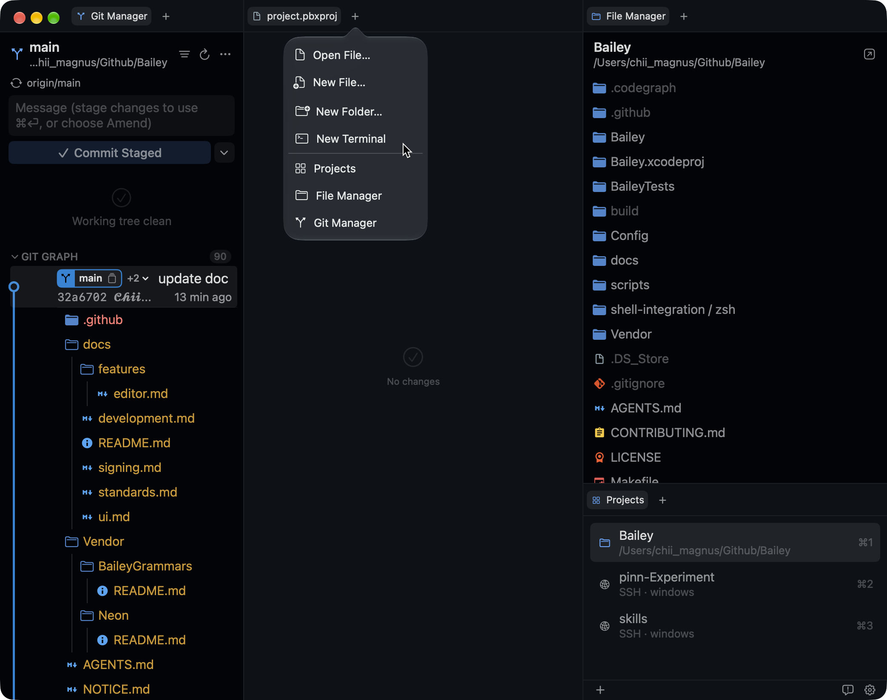
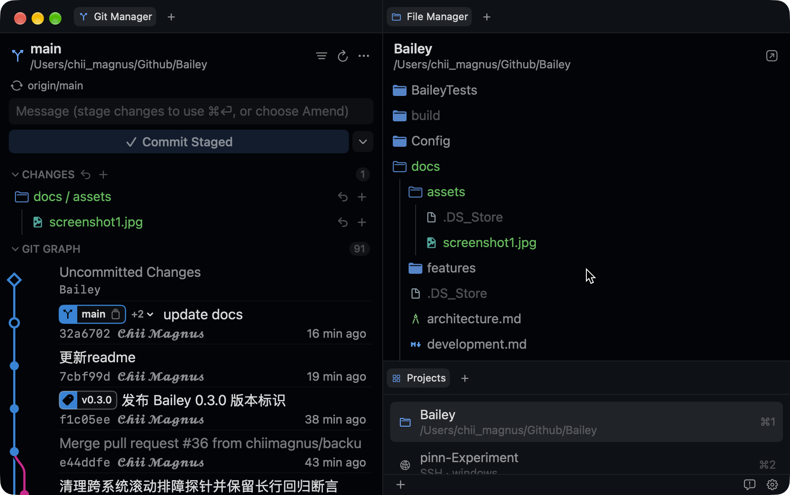

# Bailey

[简体中文](README.md) · **English**

**A flexible, native AI IDE for Mac.**

Work with source files, Git, a browser,
and AI command-line tools around your terminal in one customizable window. Requires an Apple
Silicon Mac running macOS 15.6 or later.

Bailey is an independently maintained fork of [benjaminv/kero](https://github.com/benjaminv/kero),
originally based on [egoist/kero](https://github.com/egoist/kero).

## Screenshots

<p>
  
  
</p>

## Install

1. Download `bailey-X.Y.Z-macos-arm64.zip` from [GitHub Releases](https://github.com/chiimagnus/Bailey/releases).
2. Open Bailey. If macOS blocks the launch, run:

```sh
xattr -dr com.apple.quarantine "/Applications/Bailey.app"
```

## More

- [Features and developer docs](docs/README.md) · [Build from source](docs/development.md)
- [Contributing](CONTRIBUTING.md) · [Report a bug](https://github.com/chiimagnus/Bailey/issues) ·
  [Security](SECURITY.md)

## License and acknowledgments

Bailey is licensed under [GPLv3](LICENSE). Thanks to Kero's original authors and subsequent
contributors; their copyright and attribution notices are preserved.
