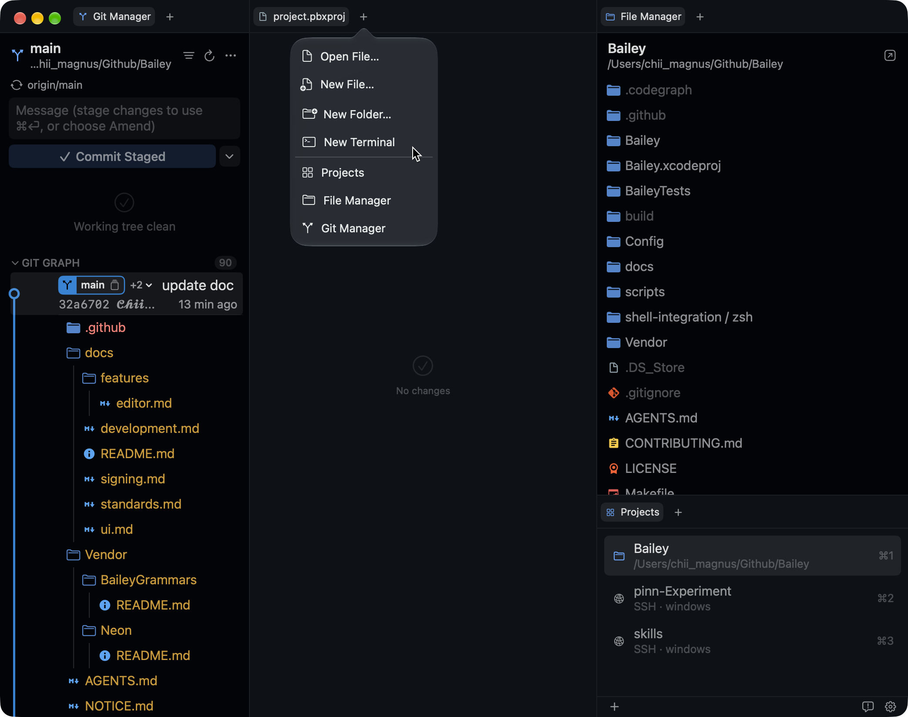
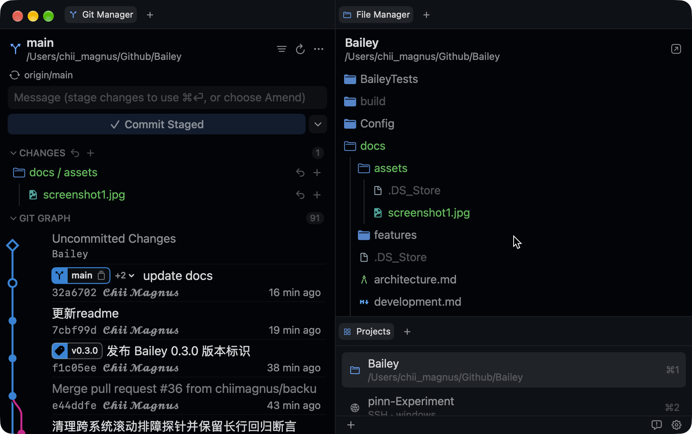

# Bailey

**简体中文** · [English](README.en.md)

**自由组装的 AI IDE。**

围绕原生终端，在同一个窗口使用代码文件、Git、浏览器和 AI 命令行工具，并自由排列。
支持 Apple Silicon，最低 macOS 15.6。

Bailey fork 自 [benjaminv/kero](https://github.com/benjaminv/kero)，最初源于
[egoist/kero](https://github.com/egoist/kero)，现独立维护。

## 截图

<p>
  
  
</p>

## 安装

1. 从 [GitHub Releases](https://github.com/chiimagnus/Bailey/releases) 下载
   `bailey-X.Y.Z-macos-arm64.zip`。
2. 打开 Bailey。若 macOS 阻止首次运行，运行:

```sh
xattr -dr com.apple.quarantine "/Applications/Bailey.app"
```

## 更多

- [功能与开发文档](docs/README.md) · [本地构建](docs/development.md)
- [参与开发](CONTRIBUTING.md) · [报告问题](https://github.com/chiimagnus/Bailey/issues) ·
  [安全报告](SECURITY.md)

## 许可证与致谢

Bailey 采用 [GPLv3](LICENSE)。感谢 Kero 原作者及后续贡献者，保留其版权与署名。
